<div align="center">


<br />

**Ứng dụng web quản lý tài chính cá nhân: thu chi, ngân sách, mục tiêu tiết kiệm, nhập sao kê ngân hàng và trợ lý AI.**

<br />


<br />

[📖 Giới thiệu](#-giới-thiệu) •
[✨ Chức năng](#-chức-năng) •
[🖼️ Giao diện](#giao-dien) •
[🧰 Công nghệ](#-công-nghệ-sử-dụng) •
[🔌 API](#-tài-liệu-api) •
[🚀 Chạy dự án](#-cách-chạy-dự-án) •
[🧪 Kiểm thử](#-kiểm-thử) •
[📚 Tài liệu](#tai-lieu) •
[👤 Tác giả](#-tác-giả)

</div>

<br />

---

## 📖 Giới thiệu

**Financial Management** giúp mỗi người theo dõi tiền của mình ở một nơi: ghi thu chi, chia theo ví và danh mục,
đặt ngân sách theo tháng, tiết kiệm cho từng mục tiêu và xem biểu đồ dòng tiền. Thay vì gõ tay từng khoản, bạn có thể
**tải file sao kê ngân hàng (CSV, Excel, PDF)** lên và để **trợ lý AI (Claude hoặc GPT của OpenAI)** đọc, phân loại giúp. Khi cần hỏi nhanh
("tháng này tôi tiêu bao nhiêu?"), **chatbot** trả lời trực tiếp từ dữ liệu của chính bạn.

Dự án được xây theo mô hình **SaaS đa người dùng**: dữ liệu của mỗi tài khoản được cách ly hoàn toàn, giao diện hoạt
động tốt trên cả máy tính và điện thoại, hỗ trợ **tiếng Việt / tiếng Anh** và **10 loại tiền tệ** (tỷ giá cập nhật tự động).

> 💡 Luồng hoạt động của từng chức năng ở [📚 Tài liệu](#tai-lieu); tài liệu sản phẩm ở [docs/PRD.md](docs/PRD.md),
> cấu trúc thư mục ở [docs/STRUCTURE.md](docs/STRUCTURE.md).

## ✨ Chức năng

|     | Chức năng                   | Mô tả                                                                                                                                                                                                             |
| :-: | --------------------------- | ----------------------------------------------------------------------------------------------------------------------------------------------------------------------------------------------------------------- |
| 🔐  | **Tài khoản người dùng**    | Đăng ký, đăng nhập, đăng xuất. Phiên dùng JWT ngắn hạn (15 phút) kèm refresh token xoay vòng; phát hiện token bị dùng lại thì thu hồi toàn bộ phiên. Mật khẩu băm bằng scrypt. · [chi tiết](docs/auth-flow.md)    |
| 👛  | **Ví / tài khoản**          | Tiền mặt, ngân hàng, ví điện tử, thẻ tín dụng; mỗi ví một loại tiền. Lưu trữ / khôi phục thay vì xóa. Số dư luôn khớp với tổng giao dịch. · [chi tiết](docs/account-flow.md)                                      |
| 🏷️  | **Danh mục**                | Danh mục mặc định của hệ thống (do admin quản lý) và danh mục riêng, có danh mục con (một cấp), biểu tượng và màu. · [chi tiết](docs/category-flow.md)                                                            |
| 💸  | **Giao dịch**               | Thu, chi, chuyển khoản giữa hai ví (kể cả khác tiền tệ). Lọc theo ví, danh mục, loại, khoảng ngày; phân trang. · [chi tiết](docs/transaction-flow.md)                                                             |
| 📥  | **Nhập sao kê**             | Tải CSV / Excel / PDF, xem trước, ghép cột, chống trùng, **hoàn tác** cả lô hoặc **xóa** lần nhập kèm giao dịch. Có file mẫu để tải về. · [chi tiết](docs/import-flow.md)                                         |
| 🤖  | **Trợ lý AI đọc sao kê**    | Claude hoặc GPT đọc toàn bộ file (bất kỳ bố cục nào, kể cả PDF), liệt kê giao dịch và gợi ý danh mục; bạn xem lại và sửa từng dòng trước khi ghi. · [chi tiết](docs/import-flow.md)                               |
| 📊  | **Ngân sách**               | Hạn mức theo tháng, theo danh mục hoặc tổng. Cảnh báo khi dùng từ 80% và khi vượt. Sao chép ngân sách từ tháng trước. · [chi tiết](docs/budget-flow.md)                                                           |
| 🐷  | **Mục tiêu tiết kiệm**      | Số tiền mục tiêu, hạn chót, gửi / rút từng khoản, tiến độ và gợi ý "cần bao nhiêu mỗi tháng". · [chi tiết](docs/savings-flow.md)                                                                                  |
| 📈  | **Tổng quan & báo cáo**     | Thẻ số dư, thu / chi / chênh lệch, chi tiêu theo danh mục, xu hướng 6 tháng, giao dịch gần đây, cảnh báo ngân sách. · [chi tiết](docs/dashboard-flow.md)                                                          |
| 📄  | **Sao kê PDF**              | Xuất sao kê theo khoảng thời gian tùy chọn cho một ví hoặc tất cả, bố cục như sao kê ngân hàng: số dư đầu kỳ, ghi nợ, ghi có, số dư cuối kỳ và từng giao dịch. · [chi tiết](docs/statement-flow.md)               |
| 🌐  | **Đa ngôn ngữ, đa tiền tệ** | Chuyển Việt / Anh tại chỗ. Giao dịch ngoại tệ được quy đổi theo tỷ giá thật (ExchangeRate-API), admin có thể nhập tay khi nguồn lỗi. · [chi tiết](docs/currency-flow.md)                                          |
| 🌙  | **Giao diện sáng / tối**    | Chế độ tối với bảng màu tím đêm, đổi tức thì bằng nút cạnh VI/EN hoặc chọn "Theo thiết bị" trong Cài đặt. Lựa chọn lưu trên từng thiết bị, trang hiện đúng màu ngay từ lần tải đầu. · [chi tiết](docs/ui-flow.md) |
| 💬  | **Chatbot AI**              | Hỏi đáp về chi tiêu, ngân sách, số dư và cách dùng app. Chỉ đọc, không sửa được dữ liệu. · [chi tiết](docs/chat-flow.md)                                                                                          |
| 📱  | **Responsive**              | Thanh bên trên máy tính, thanh điều hướng dưới đáy như app ngân hàng trên điện thoại. · [chi tiết](docs/ui-flow.md)                                                                                               |

<a id="giao-dien"></a>

## 🖼️ Giao diện

<div align="center">

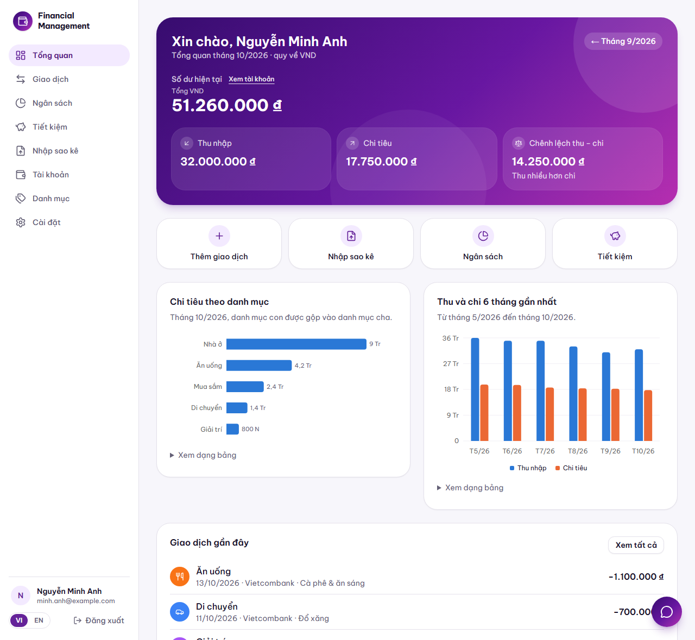

<sub>📊 <b>Tổng quan</b> — thẻ số dư, thu chi, biểu đồ theo danh mục và theo tháng</sub>

<br /><br />

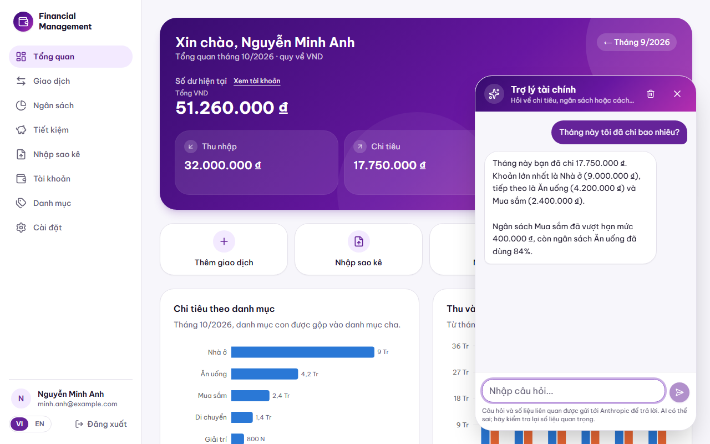

<sub>💬 <b>Trợ lý chatbot</b> — trả lời từ dữ liệu của chính bạn (ảnh minh họa với câu trả lời dựng sẵn)</sub>

</div>

<br />

<table>
  <tr>
    <td width="50%" align="center">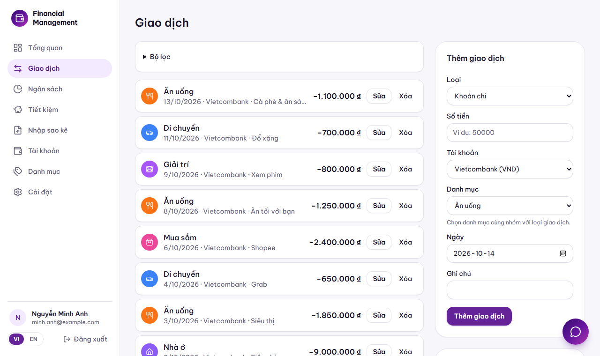<br /><sub>💸 Giao dịch</sub></td>
    <td width="50%" align="center">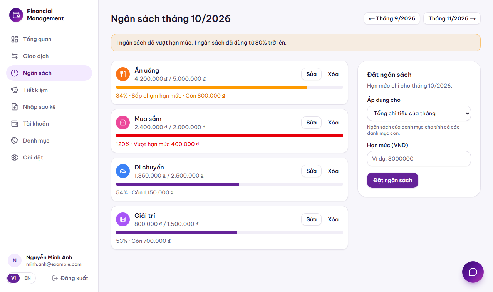<br /><sub>📊 Ngân sách và cảnh báo</sub></td>
  </tr>
  <tr>
    <td width="50%" align="center">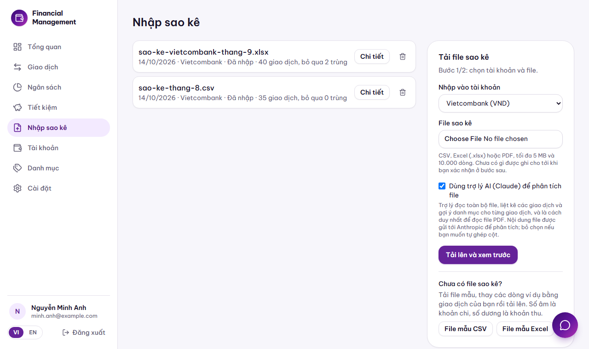<br /><sub>📥 Nhập sao kê (có nút xóa từng lần nhập)</sub></td>
    <td width="50%" align="center">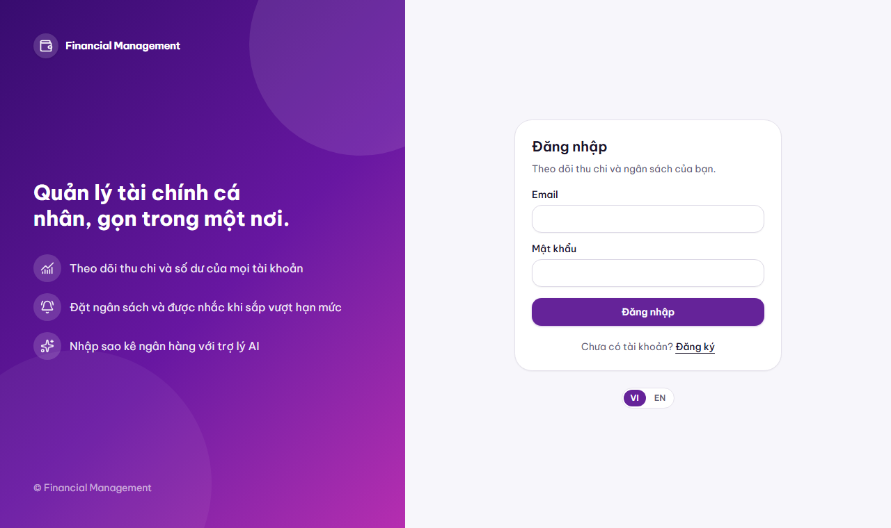<br /><sub>🔐 Đăng nhập</sub></td>
  </tr>
</table>

<div align="center">

<br />

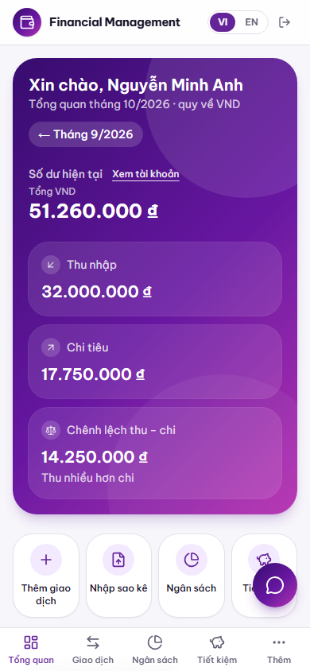
&nbsp;
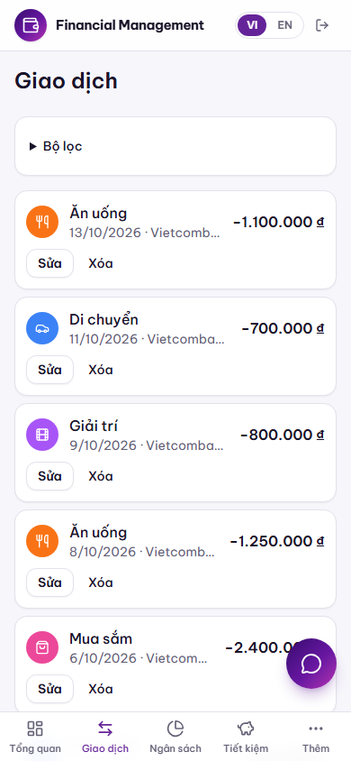
&nbsp;
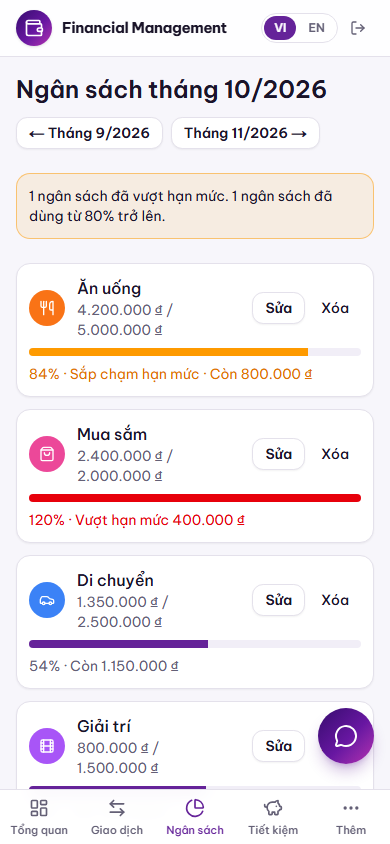

<sub>📱 Trên điện thoại: thanh điều hướng dưới đáy, nội dung xếp một cột</sub>

<br /><br />

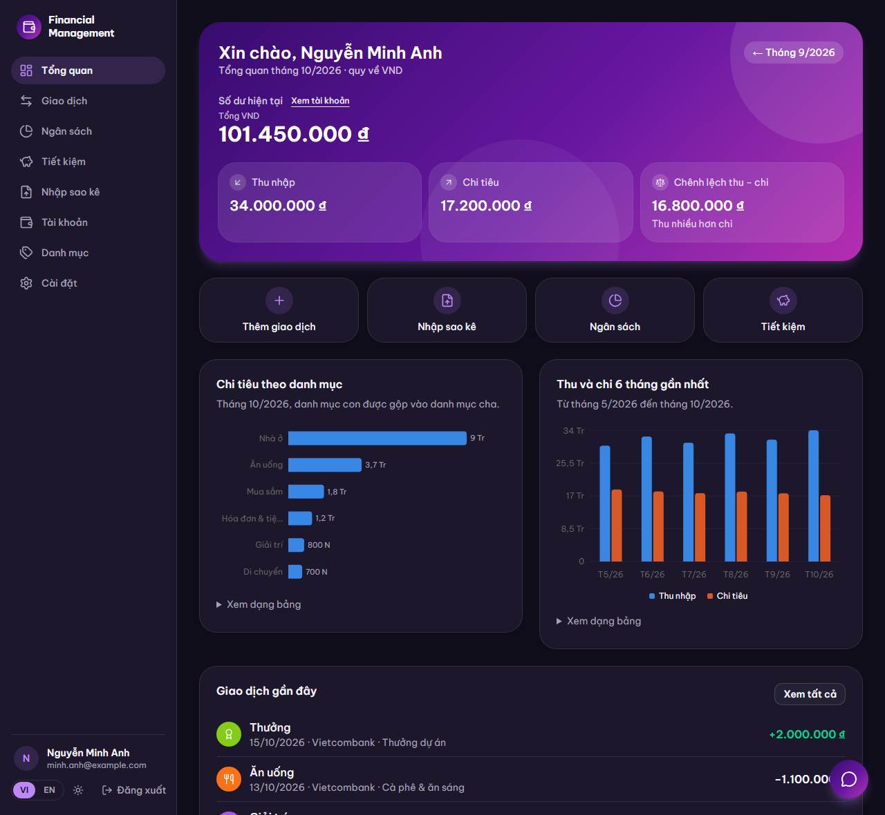
&nbsp;
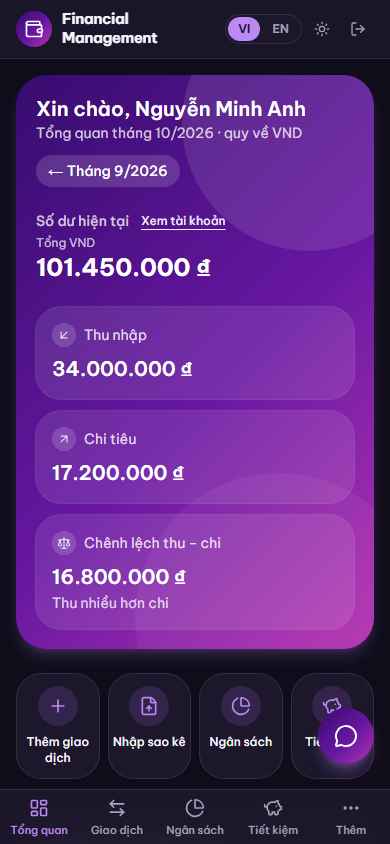

<sub>🌙 <b>Giao diện tối</b> — đổi bằng nút cạnh VI/EN, hoặc để tự theo thiết bị</sub>

<br /><br />

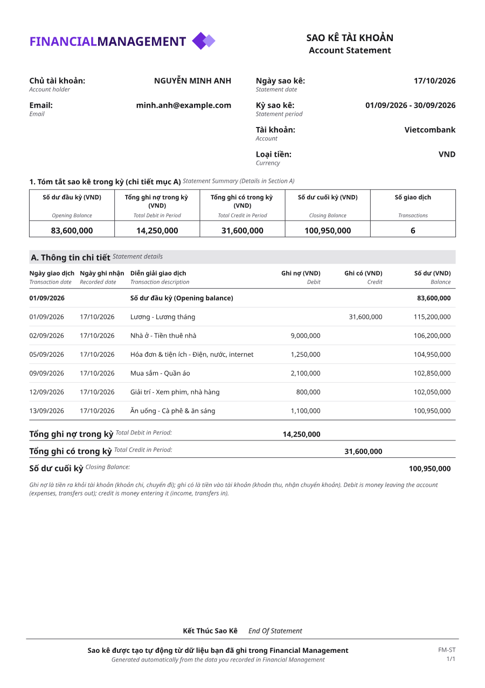

<sub>📄 <b>Sao kê PDF</b> — xuất theo khoảng thời gian bất kỳ, bố cục như sao kê ngân hàng</sub>

</div>

## 💻 Yêu cầu hệ thống

| Thành phần                         | Yêu cầu                   | Ghi chú                                                                                                                            |
| ---------------------------------- | ------------------------- | ---------------------------------------------------------------------------------------------------------------------------------- |
| **Node.js**                        | **22 trở lên**            | Dự án dùng `process.loadEnvFile`, `import.meta.dirname`, `URL.parse`. Đã chạy trên 25.9.                                           |
| **npm**                            | 10 trở lên                | Dùng npm workspaces (một `node_modules` chung).                                                                                    |
| **PostgreSQL**                     | 14 trở lên                | Đã chạy trên 18. Cần một database trống và một tài khoản có quyền tạo bảng.                                                        |
| **Hệ điều hành**                   | Windows, macOS hoặc Linux | Đã phát triển và kiểm thử trên Windows 11.                                                                                         |
| **Trình duyệt**                    | Edge hoặc Chrome          | Chỉ cần để chạy bộ kiểm thử trình duyệt (tùy chọn); các bộ còn lại không cần.                                                      |
| **Khóa API Anthropic hoặc OpenAI** | Tùy chọn                  | Cần cho trợ lý đọc sao kê, đọc PDF và chatbot (một trong hai là đủ). Không có khóa thì các tính năng còn lại vẫn chạy bình thường. |
| **Mạng Internet**                  | Tùy chọn                  | Để lấy tỷ giá (open.er-api.com) và gọi API AI. Mất mạng thì app dùng tỷ giá đã lưu.                                                |
| **Tài nguyên**                     | ~1 GB RAM, ~1 GB ổ đĩa    | Chủ yếu cho `node_modules` và bản build.                                                                                           |

## 🧰 Công nghệ sử dụng

<table>
  <tr>
    <th align="left" width="130">Tầng</th>
    <th align="left">Công nghệ</th>
    <th align="left">Dùng để</th>
  </tr>
  <tr>
    <td><b>🎨 Frontend</b></td>
    <td>
      
      
      
      
      
      
    </td>
    <td>App Router, Server Component và Server Action; giao diện, biểu đồ, biểu tượng; <code>decimal.js</code> để không mất độ chính xác của số tiền.</td>
  </tr>
  <tr>
    <td><b>⚙️ Backend</b></td>
    <td>
      
      
      
      
      
    </td>
    <td>API REST, validate mọi đầu vào bằng Zod, xác thực JWT + refresh token, tỷ giá, báo cáo; <code>papaparse</code> và <code>exceljs</code> đọc CSV / Excel; <code>pdfkit</code> dựng sao kê PDF (font Noto Sans nhúng sẵn).</td>
  </tr>
  <tr>
    <td><b>🗄️ Database</b></td>
    <td>
      
      
    </td>
    <td>Schema và migration, kết nối qua <code>@prisma/adapter-pg</code>; số tiền lưu <code>Decimal(18,2)</code>, ràng buộc CHECK và chỉ mục riêng viết trong migration.</td>
  </tr>
  <tr>
    <td><b>🤖 AI</b></td>
    <td>
      
      
      
    </td>
    <td>Claude (Messages API) hoặc OpenAI (Responses API), chọn bằng <code>AI_PROVIDER</code>. Đọc sao kê (đầu ra có cấu trúc, đọc PDF), chatbot có công cụ chỉ đọc dữ liệu người dùng, streaming.</td>
  </tr>
  <tr>
    <td><b>🧪 Kiểm thử</b></td>
    <td>
      
      
      
    </td>
    <td>690 kiểm tra đầu-cuối chạy cả hệ thống; một trình duyệt thật điều khiển qua DevTools Protocol; máy chủ AI giả (Claude và OpenAI) để không tốn tiền khi test.</td>
  </tr>
</table>

### 🏗️ Kiến trúc

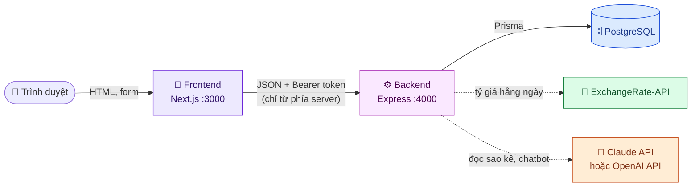

- **Trình duyệt chỉ nói chuyện với frontend.** Frontend gọi backend ở phía server, nên cookie đăng nhập là `httpOnly`, không cần CORS và token không bao giờ lọt vào JavaScript của trang.
- **Frontend không chạm database và không giữ bí mật nào.** Một luật ESLint chặn import mã từ backend hoặc database vào frontend.
- **Backend là nơi duy nhất kiểm tra quyền và validate.** Mọi truy vấn đều lọc theo người dùng hiện tại.
- **Chỉ backend import gói `database`.**

### 📁 Cấu trúc thư mục

```text
Financial Management/
├── 🎨 frontend/   Next.js: trang, component, Server Action (chỉ giao diện)
├── ⚙️ backend/    Express API: nghiệp vụ, xác thực, AI, đọc file, sao kê PDF
├── 🗄️ database/   Prisma: schema, migration, seed
├── 🔗 shared/     Mã dùng chung: bản dịch vi/en, định dạng tiền và ngày, nhãn
├── 🧪 tests/      17 bộ kiểm thử đầu-cuối + máy chủ AI giả
├── 🛠️ scripts/    dev.mjs: chạy backend và frontend cùng lúc
├── 📚 docs/       Luồng hoạt động từng chức năng, PRD, kiến trúc, API, ảnh
├── .env           Cấu hình (không commit)
└── package.json   Gốc của npm workspaces
```

Từng thư mục con và cách thêm một chức năng: [docs/STRUCTURE.md](docs/STRUCTURE.md).

## 🔌 Tài liệu API

Backend nghe ở `http://127.0.0.1:4000`, mọi route nằm dưới tiền tố **`/api`**. API được thiết kế cho chính frontend (gọi từ phía server): route ghi nhận **các trường của form** và trả **trạng thái để hiện lại form**; lỗi nhập liệu nằm trong `state` chứ không là mã lỗi HTTP.
Xác thực bằng `Authorization: Bearer <accessToken>`, ngôn ngữ bằng header `x-locale`, số tiền là chuỗi thập phân (`{"$decimal": "1250000.50"}`).

📖 **Bảng đầy đủ từng route (tham số, phản hồi, mã lỗi, ví dụ `curl`): [docs/api.md](docs/api.md).**

| Nhóm           | Route chính                                                                                          | Chi tiết                                     |
| -------------- | ---------------------------------------------------------------------------------------------------- | -------------------------------------------- |
| 🔐 Phiên       | `/auth/register`, `login`, `logout`, `logout-everywhere`, `refresh`, `/me`                           | [auth-flow](docs/auth-flow.md)               |
| ⚙️ Cài đặt     | `/settings`, `/settings/password`, `/settings/language`, `/settings/exchange-rates/refresh`          | [settings-flow](docs/settings-flow.md)       |
| 👛 Ví          | `/accounts`, `/accounts/:id`, `archive`, `restore`                                                   | [account-flow](docs/account-flow.md)         |
| 🏷️ Danh mục    | `/categories`, `/categories/:id`                                                                     | [category-flow](docs/category-flow.md)       |
| 💸 Giao dịch   | `/transactions`, `/transactions/:id`, `/transfers`                                                   | [transaction-flow](docs/transaction-flow.md) |
| 📊 Ngân sách   | `/budgets`, `/budgets/:id`, `/budgets/copy-previous`                                                 | [budget-flow](docs/budget-flow.md)           |
| 🐷 Tiết kiệm   | `/savings`, `/savings/:id`, `contributions`, `archive`, `restore`                                    | [savings-flow](docs/savings-flow.md)         |
| 📈 Tổng quan   | `/dashboard`                                                                                         | [dashboard-flow](docs/dashboard-flow.md)     |
| 📄 Sao kê PDF  | `/reports/statement`                                                                                 | [statement-flow](docs/statement-flow.md)     |
| 📥 Nhập sao kê | `/imports`, `/imports/template`, `/imports/:id`, `confirm`, `confirm-document`, `cancel`, `rollback` | [import-flow](docs/import-flow.md)           |
| 🤖 Chatbot     | `/chat` (luồng NDJSON)                                                                               | [chat-flow](docs/chat-flow.md)               |
| 🛡️ Quản trị    | `/admin/categories`, `/admin/exchange-rates` (chỉ admin, người khác nhận `404`)                      | [admin-flow](docs/admin-flow.md)             |

<a id="cau-hinh"></a>

## ⚙️ Cấu hình

Tất cả cấu hình nằm trong **một file `.env` ở thư mục gốc** , tạo file này trước khi chạy (tham khảo `.env.example`):

| Biến                                    | Bắt buộc | Mặc định                | Mô tả                                                                                                                                                          |
| --------------------------------------- | :------: | ----------------------- | -------------------------------------------------------------------------------------------------------------------------------------------------------------- |
| `DATABASE_URL`                          |    ✅    | —                       | Chuỗi kết nối PostgreSQL.                                                                                                                                      |
| `AUTH_SECRET`                           |    ✅    | —                       | Khóa ký access token (HS256), từ 32 ký tự. Sinh nhanh: `node -e "console.log(require('crypto').randomBytes(48).toString('base64url'))"`                        |
| `AI_PROVIDER`                           |    ➖    | tự chọn                 | `anthropic` hoặc `openai`. Không đặt thì dùng nhà cung cấp có khóa (cả hai thì Claude). Đã chọn mà thiếu khóa của nó thì AI tắt, không tự chuyển sang bên kia. |
| `ANTHROPIC_API_KEY`                     |    ➖    | —                       | Khóa Claude. Có khóa AI thì ô "Dùng trợ lý AI", nút chatbot và đọc PDF mới xuất hiện.                                                                          |
| `ANTHROPIC_MODEL`                       |    ➖    | `claude-opus-5-5`       | Mô hình Claude dùng cho cả đọc sao kê và chatbot.                                                                                                              |
| `OPENAI_API_KEY`                        |    ➖    | —                       | Khóa OpenAI.                                                                                                                                                   |
| `OPENAI_MODEL`                          |    ➖    | `gpt-6.1-sol`           | Mô hình OpenAI (Responses API). Cần đọc được PDF, có structured output và cho phép ít nhất 40.000 token đầu ra. Rẻ hơn: `gpt-6-luna`.                          |
| `OPENAI_REASONING_EFFORT`               |    ➖    | mặc định của mô hình    | Mức suy luận của mô hình GPT: `none`, `low`, `medium`, `high`… Thấp hơn thì nhanh và rẻ hơn.                                                                   |
| `AI_DAILY_TOKEN_BUDGET`                 |    ➖    | `2000000`               | Số token AI cả hệ thống được dùng mỗi ngày; hết thì các tính năng AI tạm dừng tới hôm sau.                                                                     |
| `AI_USER_DAILY_TOKEN_BUDGET`            |    ➖    | `200000`                | Số token mỗi người dùng được dùng mỗi ngày.                                                                                                                    |
| `AUTH_LIMIT_PER_IP`                     |    ➖    | `30`                    | Số lần đăng nhập từ một địa chỉ trong 15 phút.                                                                                                                 |
| `REGISTER_LIMIT_PER_IP`                 |    ➖    | `10`                    | Số tài khoản tạo từ một địa chỉ trong một giờ.                                                                                                                 |
| `MAINTENANCE_INTERVAL_MS`               |    ➖    | `3600000`               | Chu kỳ dọn dẹp (lần nhập bỏ dở quá 24 giờ, file sao kê mồ côi, bộ đếm cũ).                                                                                     |
| `RATE_LIMIT_PREFIX`                     |    ➖    | —                       | Tiền tố cho bộ đếm giới hạn, khi nhiều môi trường dùng chung một database (bộ kiểm thử dùng `e2e:`).                                                           |
| `ANTHROPIC_BASE_URL`, `OPENAI_BASE_URL` |    ➖    | API chính thức          | Đổi địa chỉ API (bộ kiểm thử dùng để trỏ tới máy chủ giả).                                                                                                     |
| `PORT`                                  |    ➖    | `3000`                  | Cổng của frontend khi chạy `npm run dev` / `npm start`.                                                                                                        |
| `BACKEND_PORT`                          |    ➖    | `4000`                  | Cổng của backend.                                                                                                                                              |
| `HOST`                                  |    ➖    | `127.0.0.1`             | Địa chỉ backend lắng nghe. Giữ nguyên: backend chỉ cần frontend gọi tới.                                                                                       |
| `BACKEND_URL`                           |    ➖    | `http://127.0.0.1:4000` | Nơi frontend tìm backend (`npm run dev` tự đặt cho khớp `BACKEND_PORT`).                                                                                       |

## 🚀 Cách chạy dự án

### 1️⃣ Chuẩn bị

```bash
# Lấy mã nguồn (đường dẫn minh họa)
git clone https://github.com/copirlo20/financial-management.git
cd financial-management

# Cài thư viện cho cả bốn gói (npm workspaces)
npm install
```

Tạo database rỗng (ví dụ trong `psql`) rồi tạo file `.env` như phần [Cấu hình](#cau-hinh):

```sql
CREATE DATABASE financial_management;
```

### 2️⃣ Khởi tạo database

```bash
npm run db:deploy      # áp toàn bộ migration
npm run db:seed        # nạp 18 danh mục mặc định (chạy lại nhiều lần vẫn an toàn)
npm run db:generate    # sinh client Prisma
```

### 3️⃣ Chạy ở chế độ phát triển

```bash
npm run dev
```

| Dịch vụ     | Địa chỉ               | Ghi chú                                                 |
| ----------- | --------------------- | ------------------------------------------------------- |
| 🎨 Frontend | http://localhost:3000 | Nạp nóng khi sửa mã                                     |
| ⚙️ Backend  | http://127.0.0.1:4000 | Tự khởi động lại khi sửa mã (`/api/health` để kiểm tra) |

Mở http://localhost:3000, **Đăng ký** một tài khoản rồi bắt đầu. Muốn thử trang quản trị, đặt `role = 'ADMIN'` cho tài khoản đó trong bảng `users`.

📱 **Mở từ điện thoại hoặc máy khác cùng mạng Wi-Fi:** dùng địa chỉ ở dòng `[dev] From another device on the same network: http://<IP>:3000` mà `npm run dev` in ra. Đừng dùng dòng `Network:` của Next.js, vì đó thường là card mạng ảo (VMware, Hyper-V) mà thiết bị khác không vào được. Lần đầu Windows hỏi tường lửa cho Node.js thì chọn **Cho phép**.

### 4️⃣ Chạy bản production

```bash
npm run build          # build frontend
npm start              # chạy backend + frontend đã build
```

### 🧭 Tất cả các lệnh

Chạy ở **thư mục gốc**.

| Lệnh                  | Tác dụng                                                               |
| --------------------- | ---------------------------------------------------------------------- |
| `npm run dev`         | Chạy backend (tự nạp lại) và frontend (nạp nóng) cùng lúc              |
| `npm run build`       | Build frontend                                                         |
| `npm start`           | Chạy bản production của cả hai (cần `npm run build` trước)             |
| `npm test`            | Build, chạy cả hệ thống trên cổng riêng, chạy toàn bộ kiểm thử         |
| `npm run test:dev`    | Chạy kiểm thử vào một hệ thống **đang chạy** ở `http://localhost:3000` |
| `npm run lint`        | ESLint cho mọi gói                                                     |
| `npm run typecheck`   | Kiểm tra kiểu TypeScript cho mọi gói                                   |
| `npm run db:migrate`  | Tạo và áp migration mới sau khi sửa `database/prisma/schema.prisma`    |
| `npm run db:deploy`   | Áp các migration đã có (dùng khi triển khai)                           |
| `npm run db:generate` | Sinh lại client Prisma                                                 |
| `npm run db:seed`     | Nạp danh mục mặc định                                                  |

### 🛠️ Gặp lỗi?

| Triệu chứng                                               | Nguyên nhân thường gặp                                                                                          | Cách xử lý                                                                                                                                 |
| --------------------------------------------------------- | --------------------------------------------------------------------------------------------------------------- | ------------------------------------------------------------------------------------------------------------------------------------------ |
| `Cannot find module '…/generated/client'`                 | Chưa sinh client Prisma                                                                                         | `npm run db:generate`                                                                                                                      |
| `DATABASE_URL is not set` / không kết nối được            | Thiếu `.env` hoặc sai thông tin                                                                                 | Kiểm tra `.env`, PostgreSQL đã chạy chưa, database đã tạo chưa                                                                             |
| `AUTH_SECRET must be set and at least 32 characters long` | Thiếu hoặc quá ngắn                                                                                             | Thêm `AUTH_SECRET` ≥ 32 ký tự                                                                                                              |
| `EADDRINUSE`                                              | Cổng 3000 / 4000 đang bị chiếm                                                                                  | Đặt `PORT` / `BACKEND_PORT` khác, hoặc tắt tiến trình đang chiếm cổng                                                                      |
| Không thấy nút chatbot                                    | Backend chưa có khóa AI, hoặc `AI_PROVIDER` chọn nhà cung cấp chưa có khóa (backend ghi cảnh báo khi khởi động) | Thêm `ANTHROPIC_API_KEY` hoặc `OPENAI_API_KEY` vào `.env` rồi chạy lại `npm run dev`                                                       |
| `invalid x-api-key` (401 từ Anthropic)                    | Đang dùng **ID** của khóa (`apikey_…`) thay vì khóa bí mật                                                      | Dùng khóa bí mật `sk-ant-…` (chỉ hiện một lần lúc tạo)                                                                                     |
| "Tài khoản của trợ lý AI đã hết tín dụng"                 | Tài khoản API chưa nạp tiền hoặc đã hết (OpenAI báo `insufficient_quota`)                                       | Nạp tiền ở trang billing của nhà cung cấp                                                                                                  |
| Mở từ thiết bị khác: không vào được, hoặc trang hiện ra nhưng bấm không có tác dụng | Dùng IP của card mạng ảo, tường lửa chặn Node.js, mạng Wi-Fi khách cách ly các thiết bị, hoặc mở bằng IP không thuộc máy chạy app (`allowedDevOrigins` tự lấy mọi IP của máy) | Dùng địa chỉ dòng `[dev] From another device…`; cho Node.js qua tường lửa; dùng cùng mạng Wi-Fi chính. Với `npm start` (production), cookie đăng nhập là `Secure` nên phải mở qua HTTPS mới đăng nhập được từ máy khác |
| Log có `A tree hydrated but some attributes … __gcruniqueid` / `__gcrremoteframetoken` | Chrome trên iPhone tự gắn các thuộc tính này vào form và ô nhập (tính năng tự điền) trước khi React chạy. Vô hại | `frontend/instrumentation-client.ts` đã bỏ riêng cảnh báo này khi chạy `npm run dev`; nếu vừa thêm file, chạy lại `npm run dev` |
| Trang báo lỗi, log có `ECONNREFUSED` / `ECONNRESET` / `Backend not reachable` | Backend đang khởi động lại (`npm run dev` nạp lại khi bạn sửa mã backend), bị crash, hoặc mã backend có lỗi | Frontend tự chờ tới ~5 giây (khi kết nối bị cắt giữa chừng thì chỉ thử lại yêu cầu đọc; với thao tác ghi, form báo "Mất kết nối tới máy chủ khi đang lưu…" để bạn kiểm tra rồi làm lại); backend crash lúc đang chạy thì `npm run dev` tự chạy lại (tối đa 3 lần/phút). Nếu vẫn lỗi, xem các dòng `[backend]` / `[dev]` phía trên, sửa lỗi, lưu file rồi bấm Thử lại. Phiên đăng nhập không bị mất |

## 🧪 Kiểm thử

Bộ kiểm thử chạy **cả hệ thống thật** (frontend + backend + PostgreSQL) nên bắt được lỗi ở mọi tầng: **17 bộ, 690 kiểm tra** (gồm hai bộ AI chạy lại với OpenAI). Mỗi bộ tự tạo người dùng `e2e-*@example.com` và xóa đi sau khi chạy.

```bash
npm test                          # toàn bộ: build, chạy, tắt
npm test -- auth budgets          # chỉ các bộ có tên chứa các từ này
E2E_VERBOSE=1 npm test -- imports # in từng kiểm tra, không chỉ kiểm tra lỗi
```

> ⚠️ Các bộ kiểm thử **ghi vào database trong `.env`**: hãy dùng database phát triển, không dùng dữ liệu thật (trình chạy từ chối nếu `DATABASE_URL` không trỏ về máy bạn).
> Không API AI thật nào bị gọi: backend được trỏ tới một máy chủ giả trả lời được cả kiểu Claude lẫn OpenAI.

📖 Danh sách từng bộ và số kiểm tra, cách trình chạy hoạt động, biến môi trường: **[docs/testing.md](docs/testing.md)**.

## 🔐 Bảo mật

- 🔑 Mật khẩu băm **scrypt**; phiên JWT 15 phút kèm refresh token xoay vòng; đăng xuất hay đổi mật khẩu làm token mất hiệu lực ngay.
- 🚦 Chống đoán mật khẩu và lạm dụng: giới hạn theo email, theo địa chỉ, theo giờ (đăng ký, AI, xuất PDF) và **hạn mức token AI mỗi ngày**.
- 🛡️ Content Security Policy với nonce, chống clickjacking, cookie `httpOnly`; backend chỉ nghe ở `127.0.0.1`.
- 🧱 Mọi đầu vào validate bằng **Zod** ở backend, mọi truy vấn lọc theo người dùng, số tiền là `Decimal` đầu-cuối.
- 🔒 File sao kê tạm tự xóa, chống "zip bomb", nội dung file và hội thoại không ghi log; AI coi nội dung file là dữ liệu chứ không phải chỉ dẫn.

📖 Chi tiết từng lớp bảo vệ và các hạn chế đã biết: **[docs/security-flow.md](docs/security-flow.md)**.

<a id="tai-lieu"></a>

## 📚 Tài liệu

Chi tiết nằm trong thư mục [docs/](docs/). **Đọc [request-flow](docs/request-flow.md) trước**: đường đi chung (trình duyệt → frontend → backend → database) mà mọi chức năng đều dùng.

| Bạn cần                                                                                             | Đọc                                                                                                                                                                                                                                                                                                                                                                                                                                                                                                                                                                                                                  |
| --------------------------------------------------------------------------------------------------- | -------------------------------------------------------------------------------------------------------------------------------------------------------------------------------------------------------------------------------------------------------------------------------------------------------------------------------------------------------------------------------------------------------------------------------------------------------------------------------------------------------------------------------------------------------------------------------------------------------------------- |
| **Hiểu một chức năng hoạt động thế nào** (file nào làm gì, luồng từng bước, quy tắc, lỗi, kiểm thử) | Nền tảng: [request](docs/request-flow.md) · [auth](docs/auth-flow.md) · [security](docs/security-flow.md) · [ui](docs/ui-flow.md)<br />Dữ liệu tài chính: [account](docs/account-flow.md) · [category](docs/category-flow.md) · [transaction](docs/transaction-flow.md) · [budget](docs/budget-flow.md) · [savings](docs/savings-flow.md) · [currency](docs/currency-flow.md)<br />Nhập và báo cáo: [import](docs/import-flow.md) · [dashboard](docs/dashboard-flow.md) · [statement](docs/statement-flow.md) · [chat](docs/chat-flow.md)<br />Khác: [settings](docs/settings-flow.md) · [admin](docs/admin-flow.md) |
| **Tra cứu**                                                                                         | [Thuật toán và quy trình xử lý](docs/algorithms.md) · [API](docs/api.md) · [Kiểm thử](docs/testing.md) · [Cấu trúc thư mục](docs/STRUCTURE.md)                                                                                                                                                                                                                                                                                                                                                                                                                                                                       |
| **Thiết kế và kế hoạch**                                                                            | [PRD](docs/PRD.md) (mục tiêu, tính năng đã làm / chưa làm) · [ARCHITECTURE](docs/ARCHITECTURE.md) (kiến trúc, schema, phân quyền) · [PLAN](docs/PLAN.md)                                                                                                                                                                                                                                                                                                                                                                                                                                                             |

## 🗺️ Lộ trình

- [x] Xác thực, ví, danh mục, giao dịch, chuyển khoản
- [x] Nhập sao kê CSV / Excel / PDF, trợ lý AI, hoàn tác, xóa lần nhập
- [x] Ngân sách và cảnh báo, mục tiêu tiết kiệm
- [x] Tổng quan và biểu đồ, đa ngôn ngữ, đa tiền tệ với tỷ giá thật
- [x] Giao diện mới, chế độ tối, chatbot AI, tách frontend / backend / database
- [x] Xuất sao kê PDF theo khoảng thời gian
- [ ] Tự đồng bộ giao dịch ngân hàng qua webhook của SePay / Casso
- [ ] Giao dịch định kỳ và nhắc hóa đơn
- [ ] Chia sẻ sổ chung cho gia đình
- [ ] Kết nối Open API ngân hàng trực tiếp (khi có thỏa thuận với ngân hàng)
- [ ] Ứng dụng di động

## 🤝 Đóng góp

Mọi đóng góp đều được hoan nghênh!

1. **Fork** repo và tạo nhánh: `git checkout -b feature/ten-tinh-nang`
2. Viết mã, **thêm kiểm thử**, rồi chạy `npm run lint && npm run typecheck && npm test`
3. Commit rõ ràng và mở **Pull Request**

Quy ước chính: Server Component là mặc định (chỉ thêm `"use client"` khi cần tương tác), mọi đầu vào validate bằng Zod
ở backend, mọi thao tác dữ liệu phải kiểm tra quyền ở backend, thêm bản dịch tiếng Anh cho mọi câu tiếng Việt mới
(`shared/src/i18n/en.ts`). Xem [CLAUDE.md](CLAUDE.md) và [docs/STRUCTURE.md](docs/STRUCTURE.md) để biết cách thêm một tính năng.

## 👤 Tác giả

<div align="center">

<table>
  <tr>
    <td align="center" width="220">
      <a href="https://github.com/copirlo20">
        
      </a>
      <br />
      <sub>Backend Developer</sub>
      <br />
      <b>Nguyễn Trọng Đạt</b>
    </td>
    <td align="left">
      <p>👋 Xin chào! Mình là người xây dựng <b>Financial Management</b> Nếu thấy hay, hãy tặng dự án ⭐</p>
      <p>
        🐙 GitHub: <a href="https://github.com/copirlo20">Nguyễn Trọng Đạt</a><br />
        📧 Email: <a href="mailto:copirlo20@gmail.com">copirlo20@gmail.com</a><br />
        💜 Donate (TPBank): <code>050296 99999</code> · NGUYEN TRONG DAT<br />
      </p>
    </td>
  </tr>
</table>
</div>
