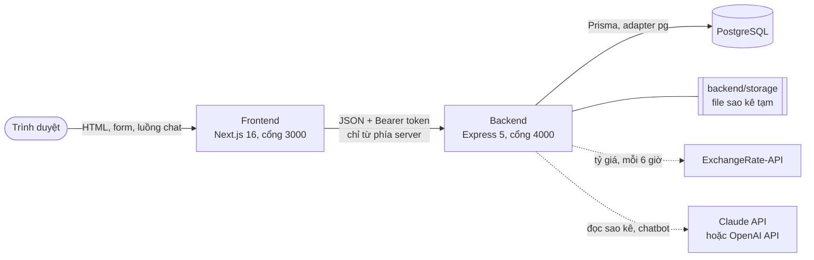
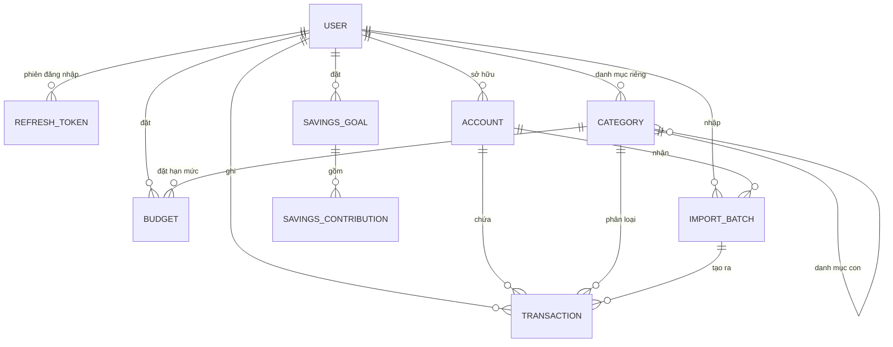

# Kiến trúc

Tài liệu này mô tả **kiến trúc hiện tại**: các thành phần, cơ sở dữ liệu, API, phân quyền và những quyết định thiết kế kèm rủi ro còn lại.
Cách từng chức năng hoạt động nằm ở các tài liệu `*-flow.md` (mục lục: [README](../README.md#tai-lieu)); cấu trúc thư mục ở [STRUCTURE.md](STRUCTURE.md);
mục tiêu sản phẩm ở [PRD.md](PRD.md).

---

## 1. Tổng quan hệ thống

| Thành phần | Công nghệ | Vai trò |
| --- | --- | --- |
| **Frontend** | Next.js 16 (App Router), React 19, Tailwind 4, shadcn/ui, Recharts | Giao diện. Server Component dựng trang, Server Action chuyển form sang backend. **Không có nghiệp vụ, không chạm database, không giữ bí mật.** |
| **Backend** | Express 5, Zod, `jose` (JWT), scrypt, `exceljs`, `papaparse`, `pdfkit`, SDK của Anthropic và OpenAI | Toàn bộ nghiệp vụ, xác thực, kiểm tra quyền, validate, đọc file, gọi AI, dựng PDF. Mặc định chỉ nghe ở `127.0.0.1`. |
| **Database** | PostgreSQL, Prisma 7 (`@prisma/adapter-pg`) | Lưu dữ liệu. Số tiền `Decimal`. Ràng buộc Prisma không biểu diễn được (CHECK, chỉ mục từng phần) viết trong migration SQL. |
| **Shared** | TypeScript thuần | Mã dùng chung hai phía: bản dịch, định dạng tiền và ngày, nhãn, hằng số, kiểu dữ liệu đường truyền. |

Mô hình này là **BFF** (backend for frontend): trình duyệt chỉ nói chuyện với frontend; frontend gọi backend ở phía server. Chi tiết đường đi xem [request-flow.md](request-flow.md).

### Các quyết định

- **Tách frontend / backend / database thành các gói riêng** (npm workspaces). Bù lại bằng một gói `shared` để không lệch kiểu giữa hai phía, đặc biệt với số tiền.
- **Trình duyệt không gọi backend** → cookie phiên `httpOnly`, không cần CORS, token không bao giờ lọt vào JavaScript của trang.
- **Ranh giới được máy kiểm tra**: luật ESLint của frontend cấm import mã từ `@fm/backend`, `@fm/database`, `@prisma/*`, `pg` (chỉ được import *kiểu* từ backend).
- **Form là đơn vị giao tiếp, không phải REST thuần**: ghi dữ liệu nhận "các trường của form" và trả "trạng thái để hiện lại form" (lỗi từng trường, thông báo, chuyển trang). Cách này làm form hoạt động tại chỗ với Server Action và vẫn chạy khi tắt JavaScript.
- **Bộ đếm giới hạn lưu trong database** (không trong bộ nhớ) để dùng chung nhiều tiến trình và không mất khi khởi động lại ([security-flow.md](security-flow.md)).
- **AI qua một giao diện chung** (`backend/src/ai/model.ts`) với hai bản cài đặt (Claude, OpenAI), chọn bằng `AI_PROVIDER`; không có khóa thì mọi chức năng AI tắt, phần còn lại vẫn chạy.

### Rủi ro và hạn chế

- Backend lưu file sao kê tạm trên **đĩa cục bộ**: triển khai nhiều instance hoặc hệ thống tệp tạm thời cần thay bằng lưu trữ đối tượng (đã gom sau ba hàm trong `imports/storage.ts`).
- Giới hạn theo địa chỉ phụ thuộc `X-Forwarded-For`; mở thẳng Next.js ra Internet thì địa chỉ có thể bị giả ([security-flow.md](security-flow.md)).
- Có hai nguồn bên ngoài: nguồn tỷ giá (có dự phòng bằng tỷ giá đã lưu) và nhà cung cấp AI (tùy chọn).

---

## 2. Cơ sở dữ liệu

Nguồn sự thật: [database/prisma/schema.prisma](../database/prisma/schema.prisma) và [migrations/](../database/prisma/migrations/).

`EXCHANGE_RATE` (tỷ giá) và `RATE_LIMIT` (bộ đếm giới hạn) đứng riêng, không có khóa ngoại.

### Các bảng

**`users`**

| Trường | Kiểu | Ghi chú |
| --- | --- | --- |
| `id` | uuid, PK | |
| `email` | string, **duy nhất** | Chuẩn hóa chữ thường |
| `passwordHash` | string | scrypt, dạng `scrypt$N$r$p$muối$khóa` |
| `name` | string | |
| `role` | `USER` hoặc `ADMIN` | Mặc định `USER` |
| `status` | `ACTIVE` hoặc `DISABLED` | Mọi yêu cầu kiểm `ACTIVE`; chưa có giao diện để khóa (đặt trực tiếp trong database) |
| `defaultCurrency` | string (ISO 4217) | Mặc định `VND`; đơn vị của mọi báo cáo |
| `locale` | `vi` hoặc `en` | |

**`refresh_tokens`**: `tokenHash` (duy nhất, **không lưu token thô**), `sessionId` (một lần đăng nhập, giữ qua các lần xoay vòng), `expiresAt`, `rotatedAt` (đã được thay, còn dùng được 10 giây), `revokedAt` (bị thu hồi hẳn). Chỉ mục theo `userId` và `sessionId`.

**`accounts`** (ví)

| Trường | Kiểu | Ghi chú |
| --- | --- | --- |
| `type` | `CASH`, `BANK`, `E_WALLET`, `CREDIT_CARD`, `OTHER` | |
| `currency` | string | Mỗi ví **một** tiền tệ, không đổi sau khi tạo |
| `initialBalance` | `Decimal(18,2)` | Có thể âm |
| `currentBalance` | `Decimal(18,2)` | **Lưu sẵn**, cập nhật cùng transaction với giao dịch |
| `archivedAt` | datetime, null | Lưu trữ thay vì xóa |

**`categories`**

| Trường | Kiểu | Ghi chú |
| --- | --- | --- |
| `userId` | FK, **null** | `NULL` = danh mục hệ thống dùng chung; có giá trị = của riêng người đó |
| `systemKey` | string, duy nhất, null | Chỉ danh mục hệ thống có; bản dịch và seed tham chiếu tới nó. CHECK: có `systemKey` **khi và chỉ khi** `userId` null |
| `parentId` | FK → categories, null | **Một cấp**; xóa cha thì con thành danh mục gốc (`SetNull`) |
| `type` | `EXPENSE` hoặc `INCOME` | Không đổi sau khi tạo |
| `icon`, `color` | string | Một trong 30 biểu tượng, màu `#RRGGBB` |

**`transactions`**

| Trường | Kiểu | Ghi chú |
| --- | --- | --- |
| `userId`, `accountId` | FK | `userId` lặp lại để truy vấn nhanh |
| `categoryId` | FK, null | Null với chuyển khoản; xóa danh mục thì giao dịch thành "chưa phân loại" (`SetNull`) |
| `type` | `EXPENSE`, `INCOME`, `TRANSFER` | |
| `amount` | `Decimal(18,2)` | **Luôn dương** (CHECK `> 0`); chiều thu/chi suy ra từ `type` |
| `currency` | string | Tiền tệ của ví |
| `amountInDefaultCurrency`, `exchangeRateUsed` | `Decimal(18,2)`, `Decimal(24,12)`, null | **Bản chụp** quy đổi tại ngày giao dịch; `NULL` nếu lúc đó chưa có tỷ giá |
| `date` | `DATE` | Ngày giao dịch (khác `createdAt`) |
| `note` | string, null | Tối đa 200 ký tự (ở lớp validate) |
| `source` | `MANUAL` hoặc `IMPORT` | |
| `importBatchId` | FK, null | Lô nhập sao kê đã tạo ra nó |
| `dedupeHash` | string, null | sha256 chống trùng khi nhập sao kê |
| `transferGroupId`, `transferDirection` | uuid, `OUT`/`IN`, null | Chuyển khoản là **hai dòng** cùng `transferGroupId`. CHECK: hai cột này có **khi và chỉ khi** `type = TRANSFER`, và chuyển khoản không có danh mục |

Chỉ mục: `(userId, date)`, `accountId`, `categoryId`, `importBatchId`, `transferGroupId`, `dedupeHash`.

**`budgets`**: `categoryId` (null = **ngân sách tổng** của tháng), `amountLimit` (CHECK `> 0`), `currency`, `periodStart` (luôn ngày 1). Duy nhất `(userId, categoryId, periodStart)`; riêng ngân sách tổng dùng **chỉ mục duy nhất từng phần** `(userId, periodStart) WHERE categoryId IS NULL` vì PostgreSQL coi các `NULL` là khác nhau.

**`savings_goals`**: `targetAmount` (CHECK `> 0`), `currentAmount` (**lưu sẵn**), `currency`, `deadline` (null), `status` (`IN_PROGRESS`, `COMPLETED`, `ARCHIVED`). **`savings_contributions`**: `amount` (gửi dương, rút âm), `date`, `note`; xóa mục tiêu thì xóa cả lịch sử (`CASCADE`).

**`import_batches`**: `fileName`, `tempFileKey` (file tạm giữa tải lên và xác nhận), `columnMapping` (json, sau khi xác nhận), `aiAnalysis` (json, kết quả AI đọc file), `status` (`PENDING`, `PROCESSED`, `ROLLED_BACK`; `FAILED` có trong kiểu nhưng chưa dùng), `rowCount`, `importedCount`, `skippedCount`, `errorMessage`.

**`exchange_rates`**: `baseCurrency` (luôn `USD`), `quoteCurrency`, `rate` (`Decimal(18,6)`), `date`, `isManual` (admin nhập tay, bản tự động không ghi đè). Duy nhất `(baseCurrency, quoteCurrency, date)`.

**`rate_limits`**: khóa chính `(key, windowStart)`, `count` (`BigInt`): số lần hoặc số token trong một khung thời gian. Chỉ mục theo `windowStart` để dọn.

### Dữ liệu mồi và migration

- [seed.sql](../database/prisma/seed.sql) nạp **18 danh mục hệ thống** (12 chi, 6 thu), chạy lại nhiều lần an toàn (chỉ thêm cái còn thiếu theo `systemKey`): `npm run db:seed`.
- 9 migration, từ `init` tới `refresh_token_session`; `npm run db:migrate` (phát triển) và `npm run db:deploy` (triển khai).
- Xóa người dùng xóa theo cả dữ liệu của họ (`CASCADE`); chưa có chức năng xóa tài khoản trong giao diện.

### Các quyết định đáng chú ý

- **Bản chụp tỷ giá tại thời điểm giao dịch** thay vì quy đổi động lúc đọc: báo cáo lịch sử không "trôi" khi tỷ giá đổi. Thiếu tỷ giá thì để `NULL` (không bao giờ ghi số sai) và điền sau ([currency-flow.md](currency-flow.md)).
- **Số dư và tiến độ lưu sẵn** (`currentBalance`, `currentAmount`) để không phải `SUM` toàn bộ giao dịch mỗi lần xem. Đổi lại phải cập nhật **cùng một transaction** với thay đổi tạo ra chúng; chỗ có thể đua nhau dùng **khóa dòng** (`FOR UPDATE`) hoặc **một câu lệnh SQL** tính cả giá trị lẫn điều kiện.
- **Danh mục hệ thống (`userId` null) cùng bảng với danh mục riêng**: người dùng mới có sẵn danh mục mà vẫn tùy biến được; admin sửa được danh mục chung mà không chạm dữ liệu riêng.
- **Lưu trữ thay vì xóa** với ví và mục tiêu tiết kiệm: giữ lịch sử giao dịch đã liên kết.
- **`transferGroupId` + `transferDirection` thay vì bảng chuyển khoản riêng**: chuyển khoản là hai giao dịch (trừ và cộng) liên kết nhau, nên dùng lại toàn bộ logic số dư và báo cáo; CHECK trong database giữ cho hình dạng đó luôn đúng.
- **Chống trùng khi nhập sao kê bằng `dedupeHash`** có tính cả số thứ tự lần xuất hiện, nên hai khoản giống hệt trong cùng ngày vẫn được giữ cả hai ([import-flow.md](import-flow.md)).
- **Phiên (`sessionId`) trên refresh token**: access token mang mã phiên nên thu hồi phiên làm token mất hiệu lực ngay ([auth-flow.md](auth-flow.md)).
- **Ràng buộc quan trọng đặt ở database** (số tiền dương, hình dạng chuyển khoản, duy nhất ngân sách tổng, `systemKey`), không chỉ ở lớp ứng dụng.

### Rủi ro

- Số liệu lưu sẵn sẽ lệch nếu có đường ghi nào quên cập nhật trong cùng transaction; mọi đường ghi hiện tại (giao dịch, chuyển khoản, nhập sao kê, hoàn tác, xóa, tiết kiệm) đều đã theo quy tắc và được kiểm thử, nhưng đường ghi **mới** phải theo đúng quy tắc đó.
- Nhập CSV/Excel từ nhiều ngân hàng có định dạng khác nhau; chống trùng bằng băm không hoàn hảo (hai giao dịch thật sự trùng cả ngày, số tiền, diễn giải sẽ được giữ hai nhờ số thứ tự, nhưng nhập lại từng phần của một file thì có thể bỏ nhầm).
- Nguồn tỷ giá miễn phí cập nhật một lần mỗi ngày; nếu nguồn đổi định dạng hay ngừng, app dùng tỷ giá đã lưu và admin có thể nhập tay.

---

## 3. API

Tiền tố **`/api`**. Bảng đầy đủ của từng route (tham số, phản hồi, lỗi) ở [api.md](api.md); cách một yêu cầu đi qua hệ thống ở [request-flow.md](request-flow.md).

| Nhóm | Đường dẫn | Tài liệu luồng |
| --- | --- | --- |
| Phiên | `POST /auth/register`, `login`, `logout`, `logout-everywhere`, `refresh`; `GET /me`, `/health` | [auth-flow.md](auth-flow.md) |
| Cài đặt | `GET /settings`; `PUT /settings`, `/settings/password`; `POST /settings/language`, `/settings/exchange-rates/refresh` | [settings-flow.md](settings-flow.md) |
| Ví | `GET/POST /accounts`, `GET/PUT /accounts/:id`, `POST /accounts/:id/archive` và `restore` | [account-flow.md](account-flow.md) |
| Danh mục | `GET/POST /categories`, `GET/PUT/DELETE /categories/:id` | [category-flow.md](category-flow.md) |
| Giao dịch | `GET/POST /transactions`, `GET/PUT/DELETE /transactions/:id`, `POST /transfers` | [transaction-flow.md](transaction-flow.md) |
| Ngân sách | `GET/POST /budgets`, `GET/PUT/DELETE /budgets/:id`, `POST /budgets/copy-previous` | [budget-flow.md](budget-flow.md) |
| Tiết kiệm | `GET/POST /savings`, `GET/PUT/DELETE /savings/:id`, `archive`, `restore`, `POST /savings/:id/contributions`, `DELETE /savings/contributions/:id` | [savings-flow.md](savings-flow.md) |
| Tổng quan | `GET /dashboard` | [dashboard-flow.md](dashboard-flow.md) |
| Sao kê PDF | `GET /reports/statement` | [statement-flow.md](statement-flow.md) |
| Nhập sao kê | `GET /imports`, `/imports/template`, `/imports/:id`; `POST /imports`, `/imports/:id/confirm`, `confirm-document`, `cancel`, `rollback`; `DELETE /imports/:id` | [import-flow.md](import-flow.md) |
| Chatbot | `POST /chat` (trả luồng NDJSON) | [chat-flow.md](chat-flow.md) |
| Quản trị | `GET/POST /admin/categories`, `GET/PUT/DELETE /admin/categories/:id`, `GET/POST /admin/exchange-rates`, `DELETE /admin/exchange-rates/:id` | [admin-flow.md](admin-flow.md) |

### Quy ước

- **Đọc (`GET`)** trả dữ liệu cho một trang; không có hoặc không thuộc về người dùng → `404`.
- **Ghi (`POST`, `PUT`, `DELETE`)** nhận `{ "fields": [[tên, giá trị], …] }` và trả `{ state?, redirect?, tokens?, locale? }` với HTTP `200` kể cả khi nội dung form sai (lỗi nằm trong `state`).
- Xác thực bằng `Authorization: Bearer <access token>`; ngôn ngữ bằng header `x-locale`. Số tiền và ngày trong JSON được gắn nhãn (`{"$decimal": …}`, `{"$date": …}`).
- Hành động như lưu trữ, khôi phục, hoàn tác là `POST` tới một đường dẫn con (`/archive`, `/rollback`) thay vì `PATCH` một trường trạng thái.

### Các quyết định

- **Mọi route (trừ đăng ký, đăng nhập, đăng xuất, làm mới token, đổi ngôn ngữ, kiểm tra sức khỏe) yêu cầu đăng nhập**, và **mọi truy vấn lọc theo `userId` lấy từ phiên**, không bao giờ từ dữ liệu client gửi lên: chống IDOR (truy cập đối tượng không được phép).
- **Id của người khác và id không tồn tại cho cùng một kết quả** (đọc → `404`, ghi → "Không tìm thấy …"): không lộ id có tồn tại hay không.
- Nhập sao kê tách **hai bước** (tải lên → xác nhận) để người dùng xem và sửa trước khi ghi dữ liệu thật.
- Các thao tác nặng hoặc tốn tiền có giới hạn riêng (nhập bằng AI, chatbot, xuất PDF, đăng nhập, đăng ký).

### Rủi ro

- **Kiểm tra quyền sở hữu nằm ở từng view và handler** (mỗi truy vấn tự có `where: { userId }`), không có middleware chung. Cách này rõ ràng nhưng đòi hỏi kỷ luật: một route mới quên lọc `userId` sẽ là lỗ hổng. Biện pháp hiện có: các bộ kiểm thử của mọi chức năng có dữ liệu riêng (ví, giao dịch, ngân sách, tiết kiệm, nhập sao kê, sao kê PDF, chatbot…) đều thử truy cập chéo giữa hai người dùng.
- Mã lỗi `200` cho lỗi nhập liệu khiến công cụ bên ngoài không phân biệt được thành công và thất bại chỉ bằng mã HTTP; API vốn được thiết kế cho chính frontend này, không phải API công khai.
- Báo cáo tổng hợp cần chỉ mục tốt: đã có `(userId, date)` cho giao dịch từ đầu.

---

## 4. Cấu trúc thư mục

Xem [STRUCTURE.md](STRUCTURE.md). Tóm tắt: `frontend/`, `backend/`, `database/`, `shared/` là bốn gói của npm workspaces ở thư mục gốc, cùng với `tests/`, `scripts/` và `docs/`.

### Các quyết định

- **Tổ chức theo lớp trong backend** (`routes` → `handlers` ghi / `views` đọc → `data` → Prisma), không theo module từng domain: mỗi chức năng nhỏ nên một file handler và một file view là đủ, và `routes.ts` là **một bảng duy nhất** liệt kê toàn bộ API.
- **Monorepo với gói `shared`**: tránh lệch kiểu giữa frontend và backend; đặc biệt với số tiền, ngày, mã lỗi dùng chung.
- **Một file `.env` ở thư mục gốc** cho cả dự án, không commit.

### Rủi ro

- Monorepo cần thiết lập công cụ (workspaces, script chạy cả hai server, bộ kiểm thử chạy cả hệ thống); đổi lại chỉ một nơi để chạy, kiểm tra và kiểm thử.

---

## 5. Ma trận phân quyền

Có hai vai trò: **Người dùng** (chủ sở hữu dữ liệu) và **Admin**. Nguyên tắc cốt lõi: **mỗi người chỉ đọc và sửa được dữ liệu của chính mình**; chưa có khái niệm chia sẻ.

| Tài nguyên | Khách | Người dùng | Admin |
| --- | :-: | --- | --- |
| Đăng ký, đăng nhập | ✅ | | |
| Hồ sơ và cài đặt (của mình) | ❌ | Đọc, sửa tên, ngôn ngữ, tiền tệ mặc định, đổi mật khẩu, đăng xuất mọi thiết bị | Như người dùng |
| Ví, giao dịch, ngân sách, mục tiêu tiết kiệm | ❌ | Đầy đủ, **của chính mình** | Như người dùng, **chỉ của chính mình** |
| Nhập sao kê, sao kê PDF, tổng quan, chatbot | ❌ | Đầy đủ, của chính mình | Như người dùng, chỉ của chính mình |
| Danh mục hệ thống | ❌ | Chỉ đọc | **Tạo, sửa, xóa** (xóa chỉ khi chưa ai dùng) |
| Danh mục riêng | ❌ | Tạo, sửa, xóa của mình | Như người dùng; **không đọc được** của người khác |
| Tỷ giá | ❌ | Đọc gián tiếp (hiển thị), bấm cập nhật (không quá một lần mỗi 10 phút) | Thêm nhập tay, xóa nhập tay |
| Quản lý người dùng (danh sách, khóa/mở), số liệu tổng hợp ẩn danh | ❌ | ❌ | **Chưa có** |

### Các quyết định

- **Admin cố ý không đọc được dữ liệu tài chính của người dùng.** Khu vực admin chỉ có danh mục hệ thống (`userId` null) và tỷ giá; không có route nào của admin truy vấn giao dịch, ví hay ngân sách của người khác. Đây là lựa chọn ưu tiên niềm tin và quyền riêng tư cho một sản phẩm tài chính cá nhân, dù hỗ trợ khách hàng sẽ khó điều tra sự cố hơn.
- **Quyền được thi hành ở tầng truy vấn**, không chỉ ở route: mọi truy vấn trên tài nguyên của người dùng có `userId` lấy từ phiên.
- **Người không phải admin gọi route admin nhận `404`**, không phải "bị cấm", để không lộ các route này có tồn tại.
- Vai trò nằm trong access token nhưng được **kiểm lại từ database** ở mỗi yêu cầu cùng với trạng thái tài khoản và phiên ([auth-flow.md](auth-flow.md)).

### Rủi ro

- Nếu sau này cần đội hỗ trợ xem dữ liệu người dùng để gỡ lỗi, phải thiết kế thêm cơ chế truy cập tạm thời kèm nhật ký kiểm toán; nên tính trước để không phải đổi schema gấp.
- Khi làm số liệu tổng hợp cho admin, phải rà kỹ để không vô tình nối ra dữ liệu cá nhân.
- Chưa có cách tạo admin hay khóa tài khoản qua giao diện: hiện đặt `role` và `status` trực tiếp trong database.

---

## 6. Chưa làm so với thiết kế ban đầu

| Mục trong thiết kế ban đầu | Hiện trạng |
| --- | --- |
| `GET/PATCH/DELETE /users/me` | Hồ sơ nằm ở `GET/PUT /settings`; **chưa có** xóa tài khoản |
| `GET /admin/users`, khóa/mở khóa | **Chưa có** (trạng thái `DISABLED` đã được kiểm nhưng chưa có cách đặt qua giao diện) |
| `/reports/by-category`, `/trend`, `/net-worth`, `/summary` | Gộp trong một route `GET /dashboard`; **chưa có** biểu đồ tài sản ròng hay số dư theo thời gian, và chưa có xu hướng theo quý |
| `GET /budgets/:id/status` | Trạng thái ngân sách tính ngay trong `GET /budgets` |
| Job định kỳ (cron) đồng bộ tỷ giá | Tỷ giá được làm mới **theo yêu cầu** (tối đa 6 giờ một lần) ở chỗ cần dùng, không có tiến trình riêng |
| `docker-compose.yml`, `.env.example` | **Chưa có** (cấu hình trong `.env`, mô tả ở README) |
| Middleware kiểm tra quyền sở hữu dùng chung | Kiểm tra trong từng view/handler (xem rủi ro ở mục 3) |

---

## Rủi ro tổng thể cần lưu ý

1. **Quyền sở hữu (IDOR)** vẫn là rủi ro bảo mật lớn nhất của hệ nhiều người dùng; mỗi route mới phải lọc theo `userId` và có kiểm thử truy cập chéo.
2. **Nhất quán của số liệu lưu sẵn** (số dư ví, tiến độ tiết kiệm): mọi đường ghi mới phải cập nhật trong cùng transaction.
3. **Đa tiền tệ**: phụ thuộc một nguồn tỷ giá miễn phí; có dự phòng nhưng chất lượng báo cáo ngoại tệ phụ thuộc vào nó.
4. **Chi phí AI** (nhập sao kê, chatbot): đã có hạn mức theo giờ và theo ngày cho cả hệ thống và từng người; khóa AI vẫn là bí mật cần giữ trong `.env`.
5. **Nhập sao kê**: không có chuẩn chung giữa các ngân hàng; AI đọc linh hoạt nhưng có thể đọc nhầm, nên luôn có bước người dùng xem lại trước khi ghi.
