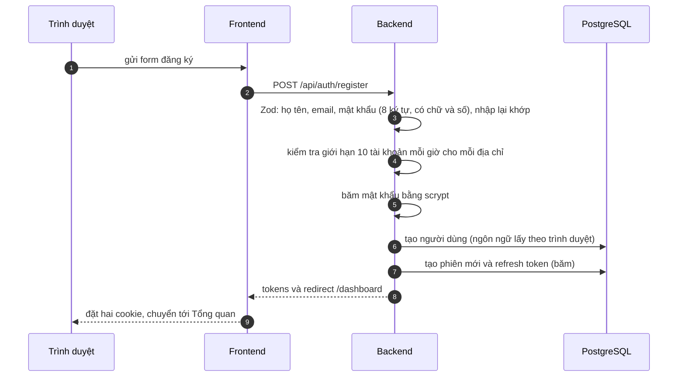
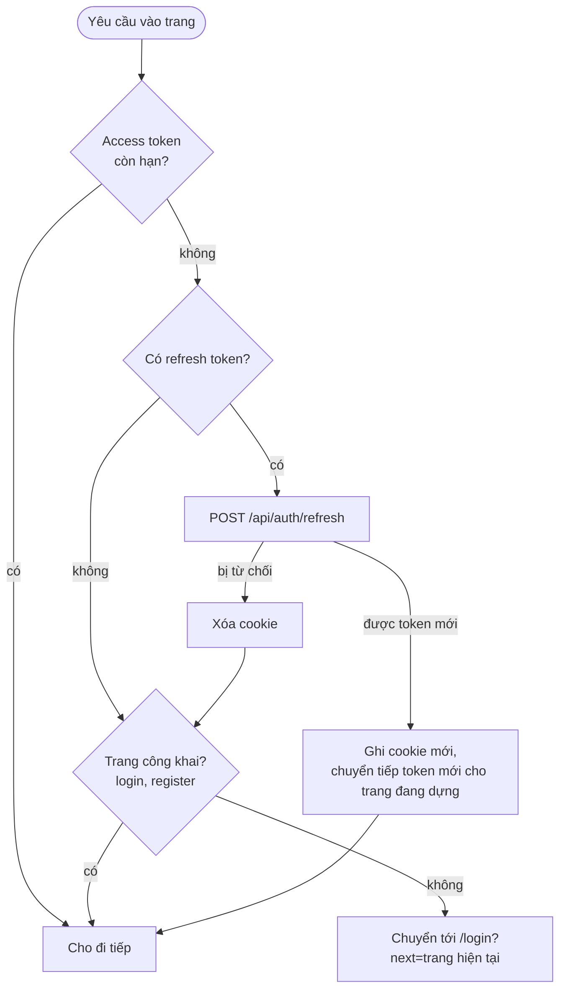

# Luồng xác thực và phiên đăng nhập

Đăng ký, đăng nhập, giữ phiên, đăng xuất, đổi mật khẩu. Đường đi chung của mọi yêu cầu xem ở [request-flow.md](request-flow.md);
các biện pháp chống lạm dụng xem ở [security-flow.md](security-flow.md).

## Khái niệm

| Khái niệm | Mô tả |
| --- | --- |
| **Access token** | JWT HS256, sống **15 phút**, mang `sub` (người dùng), `role`, `sid` (mã phiên). Gửi kèm mọi yêu cầu tới backend. |
| **Refresh token** | Chuỗi ngẫu nhiên, sống **30 ngày**, **chỉ lưu dạng băm** trong bảng `refresh_tokens`. Dùng để xin cặp token mới. |
| **Phiên** (`sessionId`) | Một lần đăng nhập trên một thiết bị. Giữ nguyên qua mọi lần xoay vòng token. Một phiên đang mở khi nó còn refresh token chưa bị thu hồi và chưa hết hạn. |
| **Cookie** | `access_token` và `refresh_token`, đều `httpOnly`, `sameSite=lax`, `secure` ở production. JavaScript của trang không đọc được. |

## Đăng ký

- Email trùng (`P2002` của Prisma) → lỗi ở trường email "Email này đã được đăng ký."
- Hệ thống băm đang quá tải → "Hệ thống đang bận. Hãy thử lại sau ít giây."
- Người dùng mới không có sẵn ví hay danh mục riêng; danh mục mặc định do hệ thống cấp (`seed.sql`).

## Đăng nhập

1. Zod kiểm tra email và mật khẩu.
2. **Trước khi băm bất kỳ mật khẩu nào**, kiểm tra giới hạn ([security-flow.md](security-flow.md)): 30 lần thử mỗi địa chỉ / 15 phút, 5 lần sai mỗi email / 15 phút. Bị từ chối thì tốn gần như không gì.
3. Tìm người dùng theo email. **Có hay không có**, đều tốn cùng một thời gian băm (`simulatePasswordCheck`), để thời gian trả lời không lộ email có đăng ký hay không.
4. Sai email hoặc sai mật khẩu → **một** thông báo chung "Email hoặc mật khẩu không đúng." và ghi nhận một lần sai cho email đó (kể cả email không tồn tại).
5. Tài khoản `status ≠ ACTIVE` → "Tài khoản đã bị khóa."
6. Đúng → tạo phiên mới, trả token, áp ngôn ngữ đã lưu của người dùng, rồi chuyển tới `next` hoặc `/dashboard`.

**Chuyển hướng sau đăng nhập (`next`):** chỉ nhận đường dẫn của chính trang web (danh sách ký tự cho phép, bắt đầu bằng đúng một `/`, và khi giải như trình duyệt vẫn ở cùng origin). Mọi thứ khác (`//evil.example`, `https://…`, `/\t/evil.example`, `javascript:`) bị đổi thành `/dashboard`. Chặn tấn công chuyển hướng ra ngoài.

## Giữ phiên: làm mới token

Access token chỉ sống 15 phút, nên việc làm mới diễn ra **tự động ở frontend**, trong [proxy.ts](../frontend/proxy.ts) chạy trước mọi yêu cầu vào trang:

Proxy chỉ **đọc hạn** của access token (không kiểm chữ ký, vì chỉ backend có khóa bí mật). Đây là cổng "lạc quan"; quyền thật được kiểm ở backend trong mỗi lần gọi.

**Phân biệt "bị từ chối" với "không hỏi được"**: chỉ khi backend trả `401` cho refresh token thì mới xóa cookie. Nếu không kết nối được (backend đang khởi động lại) hoặc backend lỗi `5xx`, proxy giữ nguyên cookie và cho trang đi tiếp; nếu coi đó là bị từ chối, mỗi lần backend khởi động lại sẽ đăng xuất mọi người. Lời gọi làm mới cũng chờ và thử lại khoảng 5 giây như mọi lời gọi tới backend ([request-flow.md](request-flow.md)).

### Xoay vòng refresh token (`POST /api/auth/refresh`)

1. Tra token theo giá trị băm. Không có, đã thu hồi hoặc hết hạn → `401`.
2. Token **chưa dùng**: đánh dấu `rotatedAt` và phát cặp token mới **cùng phiên**.
3. Token **đã được xoay trong 10 giây gần đây**: vẫn chấp nhận. Lý do: nhiều yêu cầu song song (ví dụ tải trước các trang) có thể cùng mang một token lúc access token vừa hết hạn.
4. Token **đã được xoay quá 10 giây** mà lại bị đưa ra dùng tiếp: coi là **đã bị lộ** → thu hồi **mọi** phiên của người dùng và từ chối.
5. Người dùng không còn `ACTIVE` → từ chối.

## Kiểm tra quyền ở mỗi yêu cầu

Với mỗi yêu cầu có token, `loadUser` ([auth/current-user.ts](../backend/src/auth/current-user.ts)) xác minh chữ ký rồi **hỏi database**: người dùng còn `ACTIVE` không, và phiên `sid` có còn refresh token chưa thu hồi, chưa hết hạn không. Nhờ vậy khi bị khóa, bị xóa, đăng xuất hay đổi mật khẩu, access token mất hiệu lực **ngay**, không phải chờ hết 15 phút.

## Đăng xuất

| Chức năng | Việc backend làm | Kết quả |
| --- | --- | --- |
| **Đăng xuất** (`POST /auth/logout`) | Thu hồi phiên hiện tại (cả refresh token trong header `x-refresh-token`, vì access token có thể đã hết hạn) | Cookie bị xóa, về `/login` |
| **Đăng xuất khỏi mọi thiết bị** (`POST /auth/logout-everywhere`) | Thu hồi **mọi** phiên của người dùng, kể cả phiên này | Như trên. Nút ở Cài đặt, có modal xác nhận |

## Đổi mật khẩu (Cài đặt → Bảo mật)

1. Zod: mật khẩu hiện tại, mật khẩu mới (cùng luật như đăng ký), nhập lại khớp, **khác** mật khẩu cũ.
2. Dùng chung giới hạn với đăng nhập: nhập sai mật khẩu hiện tại cũng tính vào 5 lần sai, nên form này không dùng để đoán mật khẩu được.
3. Đúng → băm mật khẩu mới, lưu, rồi **thu hồi mọi phiên khác**, giữ phiên đang dùng.
4. Mật khẩu không bao giờ được gửi lại vào form (`values` không chứa mật khẩu).

## Mật khẩu

- Băm **scrypt** (`N=2^15, r=8, p=1`, muối 16 byte), lưu dạng `scrypt$N$r$p$muối$khóa` nên có thể tăng tham số sau mà không hỏng mật khẩu cũ. So sánh bằng `timingSafeEqual`.
- Mỗi lần băm tốn khoảng 32 MB. Tối đa **4** phép băm chạy cùng lúc, **32** yêu cầu đứng chờ; quá nữa bị từ chối ngay ("Hệ thống đang bận"), để một đợt tấn công không làm nghẽn cả server.

## Dữ liệu

`users` (email duy nhất, `passwordHash`, `role`, `status`, `locale`, `defaultCurrency`), `refresh_tokens` (`tokenHash` duy nhất, `sessionId`, `expiresAt`, `rotatedAt`, `revokedAt`), `rate_limits` (bộ đếm giới hạn).

## Kiểm thử

Bộ `auth` (57 kiểm tra): đăng ký, đăng nhập, cookie, xoay vòng và thu hồi token, chuyển hướng an toàn, khóa khi đoán mật khẩu, phiên, đổi mật khẩu, đăng xuất mọi thiết bị.
