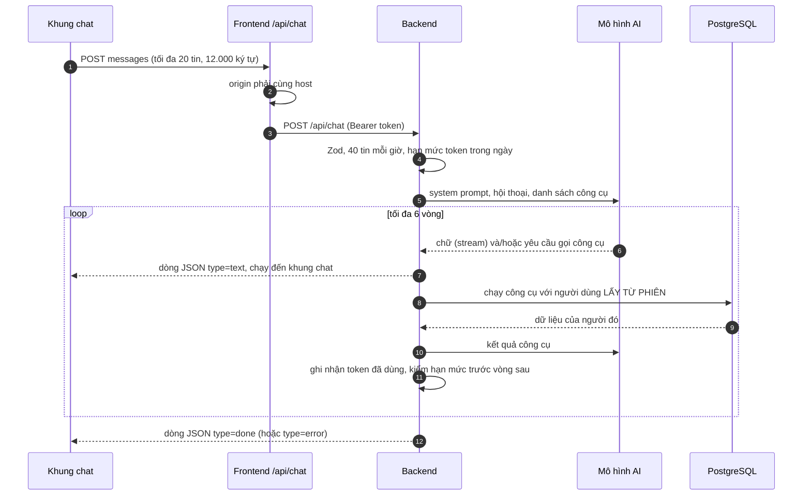

# Luồng chatbot AI

Nút tròn ở góc màn hình mở khung chat. Trợ lý trả lời câu hỏi về tài chính **của chính người dùng** (từ dữ liệu thật qua các công cụ **chỉ đọc**) và hướng dẫn dùng app.
Dùng chung nhà cung cấp AI với [nhập sao kê](import-flow.md) (Claude hoặc OpenAI, chọn bằng `AI_PROVIDER`); chưa có khóa AI thì nút không hiện.
Đường đi chung của yêu cầu xem [request-flow.md](request-flow.md).

## Thành phần

| Tầng | File |
| --- | --- |
| Giao diện | [frontend/components/chat-widget.tsx](../frontend/components/chat-widget.tsx): hội thoại chỉ nằm trong bộ nhớ của trang, tải lại là mất |
| Route chuyển tiếp | [frontend/app/api/chat/route.ts](../frontend/app/api/chat/route.ts): kiểm tra origin, chuyển tiếp sang backend, trả lại luồng nguyên vẹn |
| Handler | [backend/src/handlers/chat.ts](../backend/src/handlers/chat.ts): `POST /api/chat`, vòng gọi công cụ, trả luồng dòng JSON |
| Công cụ | [backend/src/ai/chat-tools.ts](../backend/src/ai/chat-tools.ts) |
| Chọn nhà cung cấp, hạn mức | [backend/src/ai/client.ts](../backend/src/ai/client.ts) |
| Giao diện chung và hai bản cài đặt | [ai/model.ts](../backend/src/ai/model.ts), [ai/anthropic.ts](../backend/src/ai/anthropic.ts) (Messages API), [ai/openai.ts](../backend/src/ai/openai.ts) (Responses API) |

## Luồng một câu hỏi

1. **Khung chat** ghi nhớ hội thoại trong trạng thái của trang và gửi tối đa **20 tin gần nhất, tổng 12.000 ký tự**, bắt đầu bằng một tin của người dùng (cắt ở phía trình duyệt; server kiểm lại).
2. **Frontend** chỉ nhận request từ chính trang của mình (kiểm `Origin` với `Host`), rồi chuyển sang backend kèm token và truyền ngược luồng trả lời không đổi. Phiên hết hạn → "Phiên đăng nhập đã hết hạn. Hãy đăng nhập lại."
3. **Backend** kiểm tra theo thứ tự: đã cấu hình AI (`503` nếu chưa), Zod (`400`), tối đa **40 tin mỗi giờ** (`429`), còn **hạn mức token** của ngày (`429`).
4. **Vòng gọi công cụ**: backend gửi hội thoại và danh sách công cụ cho mô hình. Mô hình có thể trả chữ, hoặc yêu cầu gọi công cụ; backend chạy công cụ, trả kết quả, và gọi tiếp. Tối đa **6 vòng**; ở vòng cuối công cụ bị khóa (`tool_choice: none`) nên mô hình phải trả lời bằng những gì đã có.
5. Sau **mỗi vòng**, token đã dùng được cộng vào bộ đếm của ngày, và hạn mức được kiểm lại **trước** vòng kế tiếp (một câu hỏi có thể cần nhiều lệnh gọi).
6. **Trả lời theo luồng** (NDJSON, mỗi dòng một sự kiện): `{"type":"text","text":"…"}` nhiều lần, rồi `{"type":"done"}`; lỗi giữa chừng là `{"type":"error","message":"…"}`. Khung chat nối các mẩu chữ lại và tự cuộn xuống. Người dùng đóng khung chat thì backend **ngừng gọi mô hình** (`AbortController`).

## Công cụ của trợ lý

Sáu công cụ, **chỉ đọc**, mọi truy vấn lọc theo người dùng của phiên:

| Công cụ | Trả về |
| --- | --- |
| `get_month_summary` | Thu, chi, chênh lệch của một tháng (tiền tệ mặc định), chi theo danh mục gốc, số dư hiện tại |
| `get_monthly_trend` | Thu và chi nhiều tháng liên tiếp (tối đa 12) |
| `get_budgets` | Ngân sách của một tháng: hạn mức, đã chi, phần trăm, trạng thái |
| `list_transactions` | Giao dịch cụ thể, lọc theo ngày, loại, danh mục, ghi chú; sắp mới nhất hoặc lớn nhất; **tối đa 50 dòng mỗi lần** kèm tổng số khớp |
| `get_accounts` | Các ví: loại, tiền tệ, số dư |
| `get_savings_goals` | Các mục tiêu tiết kiệm |

Đầu vào của mỗi công cụ được **Zod kiểm** trước khi chạy; công cụ không tồn tại hoặc đầu vào sai trả về lỗi để mô hình đọc, **không chạy**. Không có công cụ nào ghi dữ liệu: hỏi "thêm giao dịch" thì trợ lý chỉ hướng dẫn mục nào trong app để tự làm.

## An toàn

- **Người dùng lấy từ phiên đăng nhập ở server**; mô hình không chọn được đọc dữ liệu của ai khác.
- Mọi đầu vào Zod: hội thoại (tối đa 20 tin, mỗi tin 4.000 ký tự, tổng 12.000) và tham số công cụ.
- **Chi phí có trần**: 40 tin mỗi giờ mỗi người; hạn mức token mỗi ngày cho cả hệ thống (`AI_DAILY_TOKEN_BUDGET`) và cho từng người (`AI_USER_DAILY_TOKEN_BUDGET`). Hết hạn mức: "Trợ lý AI đã dùng hết hạn mức hôm nay. Hãy thử lại vào ngày mai." Bộ đếm ở bảng `rate_limits` ([security-flow.md](security-flow.md)).
- Trợ lý được dặn **chỉ nói về tài chính cá nhân và app**, từ chối việc khác (viết code, bài luận…) để không thành cổng AI miễn phí.
- Ghi chú, tên ví… trong kết quả công cụ là **dữ liệu do người dùng nhập**; prompt dặn mô hình không coi đó là chỉ dẫn.
- **Quyền riêng tư**: câu hỏi và số liệu liên quan được gửi tới nhà cung cấp AI đang dùng; khung chat ghi rõ tên (Anthropic hoặc OpenAI). Với OpenAI, request đặt `store: false`. **Backend không ghi log nội dung hội thoại.**
- Lỗi của nhà cung cấp được đổi thành câu dễ hiểu, không lộ chi tiết: khóa sai, tài khoản hết tín dụng, quá tải, hoặc lỗi chung "Trợ lý AI không trả lời được lúc này."

## Giao diện

- Trên điện thoại khung chat phủ toàn màn hình; trên máy tính là hộp 25 rem ở góc phải dưới. Nút mở nằm trên thanh điều hướng dưới (điện thoại).
- Màn hình trống có lời chào và 4 câu hỏi gợi ý; hội thoại tiếp tục khi chuyển trang trong app.
- Nút xóa hội thoại, Enter để gửi (Shift+Enter xuống dòng), ô nhập tối đa 2.000 ký tự.
- Câu trả lời là **văn bản thuần** (không Markdown, bảng hay biểu đồ).

## Giới hạn đã biết

- Chưa lưu lịch sử hội thoại; chưa hỗ trợ thao tác ghi (thêm giao dịch qua chat).
- Kết quả phụ thuộc mô hình: có thể sai, khung chat nhắc kiểm tra lại số liệu quan trọng.

## Kiểm thử

Bộ `chat` (35 kiểm tra, chạy cả với Claude lẫn OpenAI qua máy chủ AI giả [tests/mock-ai.mjs](../tests/mock-ai.mjs)): công cụ chỉ đọc, cách ly dữ liệu, giới hạn, hạn mức, lỗi; `ui` và `mobile` (khung chat trong trình duyệt thật).
