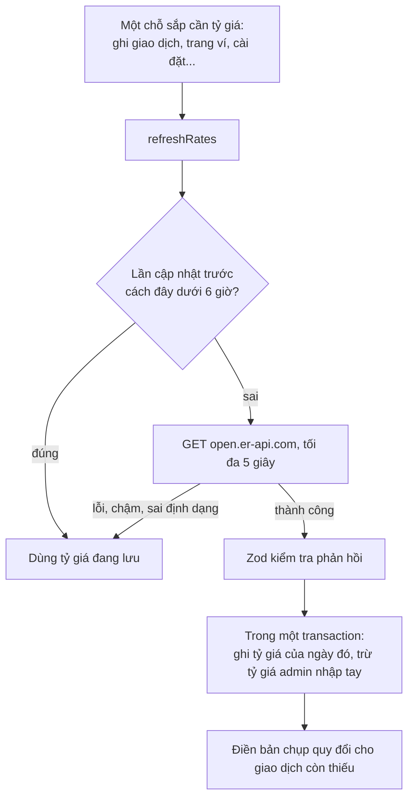
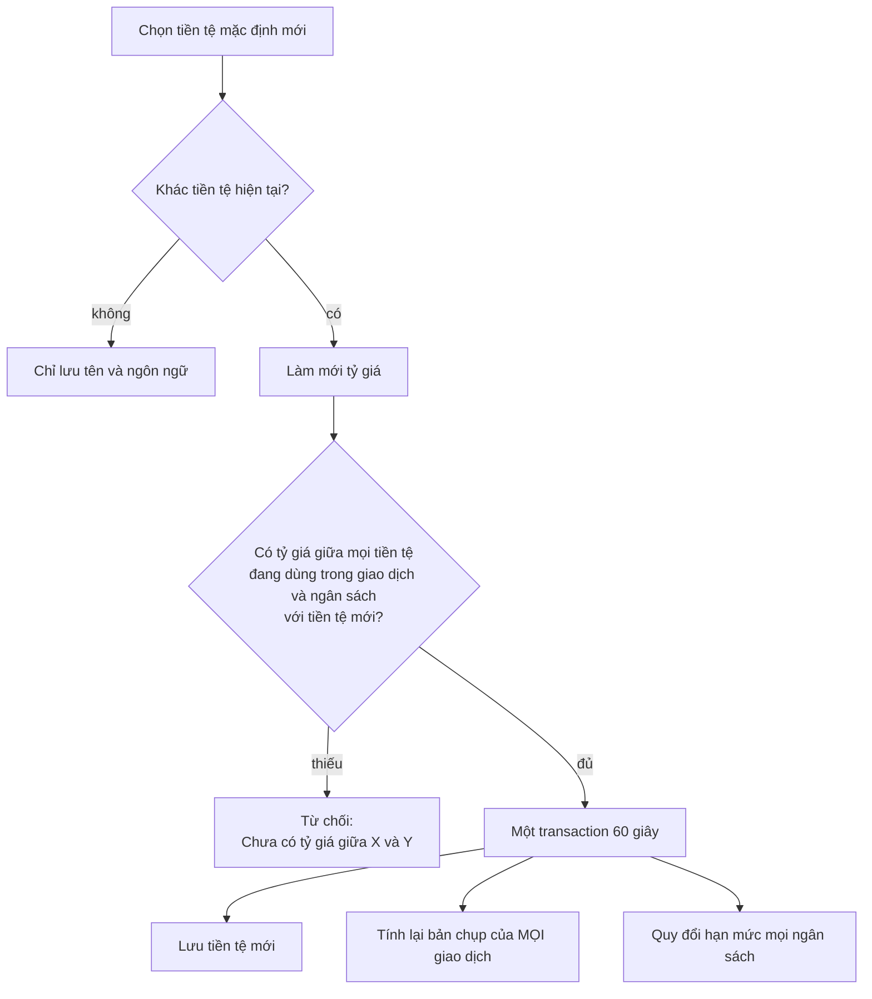

# Luồng đa tiền tệ và tỷ giá

App hỗ trợ **10 loại tiền** (VND, USD, EUR, JPY, GBP, AUD, SGD, KRW, CNY, THB). Mỗi ví một loại tiền; mọi báo cáo quy về **tiền tệ mặc định** của người dùng.
Đường đi chung của yêu cầu xem [request-flow.md](request-flow.md).

## Thành phần

| Tầng | File |
| --- | --- |
| Tỷ giá, quy đổi | [backend/src/exchange.ts](../backend/src/exchange.ts) |
| Cài đặt (tiền tệ mặc định, làm mới tỷ giá) | [backend/src/handlers/settings.ts](../backend/src/handlers/settings.ts), [validations/settings.ts](../backend/src/validations/settings.ts) |
| Tỷ giá nhập tay (admin) | [handlers/admin-exchange-rates.ts](../backend/src/handlers/admin-exchange-rates.ts), xem [admin-flow.md](admin-flow.md) |
| Trang | [frontend/app/(app)/settings/](../frontend/app/(app)/settings/) |
| Danh sách tiền, định dạng | [shared/src/currencies.ts](../shared/src/currencies.ts), [shared/src/rates.ts](../shared/src/rates.ts) |

## Dữ liệu tỷ giá

Bảng `exchange_rates`: mỗi dòng là **"1 USD = rate × tiền tệ X" trong một ngày** (`baseCurrency` luôn là USD), kèm `isManual` (do admin nhập tay).
Tỷ giá giữa hai tiền tệ bất kỳ được suy ra bằng cách **đi qua USD**: `tỷ giá(A→B) = rate(B) / rate(A)`.

Với một ngày cụ thể, tỷ giá USD của một tiền tệ là dòng **gần nhất trong số những ngày trước hoặc bằng ngày đó**; nếu không có thì lấy dòng **sớm nhất sau đó**. Nhờ vậy giao dịch cũ hơn tỷ giá đầu tiên vẫn được quy đổi xấp xỉ thay vì để trống.

## Lấy tỷ giá tự động

- Nguồn: **ExchangeRate-API** gói miễn phí, không cần khóa, cập nhật mỗi ngày một lần (Cài đặt có ghi nguồn theo yêu cầu của dịch vụ). Có thể đổi sang nguồn trả phí mà không động tới phần còn lại (`PROVIDER_URL` và bộ đọc phản hồi là chỗ duy nhất).
- `refreshRates` **không bao giờ ném lỗi** và chỉ chạy một lần tại một thời điểm (các yêu cầu cùng lúc dùng chung một lần gọi). Mất mạng hay nguồn lỗi thì app dùng tỷ giá đã lưu.
- Người dùng bấm **"Cập nhật tỷ giá"** ở Cài đặt: cho phép sớm hơn, **cách nhau tối thiểu 10 phút** ("Tỷ giá vừa được cập nhật trong 10 phút qua."); thất bại thì "Không lấy được tỷ giá mới. Đang dùng tỷ giá đã lưu."
- Tỷ giá admin nhập tay của một ngày **không bị bản tự động ghi đè**.

## Bản chụp quy đổi của giao dịch

Khi ghi giao dịch, app lưu cùng lúc `amountInDefaultCurrency` và `exchangeRateUsed` theo tỷ giá của **ngày giao dịch** ([transaction-flow.md](transaction-flow.md)). Lý do: báo cáo một tháng cũ **không đổi** khi tỷ giá hôm nay đổi, và truy vấn tổng hợp chỉ cần cộng một cột.

- Không có tỷ giá → cả hai cột để **`NULL`** (không bao giờ ghi một con số sai). Giao dịch đó bị loại khỏi tổng và được **đếm riêng** ("N giao dịch chưa có tỷ giá").
- Khi tỷ giá về (tự động hoặc admin nhập), `recomputeConversions` điền các bản chụp còn thiếu bằng **một câu lệnh SQL**. Việc này không đổi `updatedAt` (không phải người dùng sửa), nên không ảnh hưởng việc hoàn tác lần nhập sao kê.
- Bản chụp **đã có** không bị đổi khi tỷ giá mới về; chỉ những chỗ còn trống được điền (dù tỷ giá về từ nguồn tự động hay do admin nhập tay).

## Đổi tiền tệ mặc định (Cài đặt → Hồ sơ)

Việc đổi được làm **hoặc cả hai, hoặc không**: nếu thiếu tỷ giá cho dù chỉ một loại tiền thì từ chối ngay và không đổi gì. Hạn mức ngân sách được nhân theo tỷ giá hiện tại (tối thiểu 0,01 để một hạn mức nhỏ không tròn về 0).

## Tổng số dư quy đổi

`convertBalances` cộng số dư các ví đã quy về một tiền tệ theo tỷ giá **hôm nay**; loại tiền nào thiếu tỷ giá được liệt kê riêng thay vì làm sai tổng. Dùng ở trang Ví và Tổng quan ([account-flow.md](account-flow.md), [dashboard-flow.md](dashboard-flow.md)).

## Hiển thị

Số tiền định dạng bằng `Intl.NumberFormat` theo ngôn ngữ và tiền tệ (VND: `1.250.000 ₫`; USD tiếng Anh: `$1,250.50`) ở [shared/src/currencies.ts](../shared/src/currencies.ts). Tỷ giá ở Cài đặt cần độ chính xác cao hơn tiền (1 KRW khoảng 19,31 VND), nên hiển thị tối đa 6 chữ số thập phân khi tỷ giá nhỏ hơn 1, 4 chữ số khi nhỏ hơn 1.000 và 2 chữ số còn lại.

## Kiểm thử

Bộ `language-currency` (47 kiểm tra: quy đổi, đổi tiền tệ mặc định, thiếu tỷ giá, tỷ giá nhập tay) và `dashboard`.
