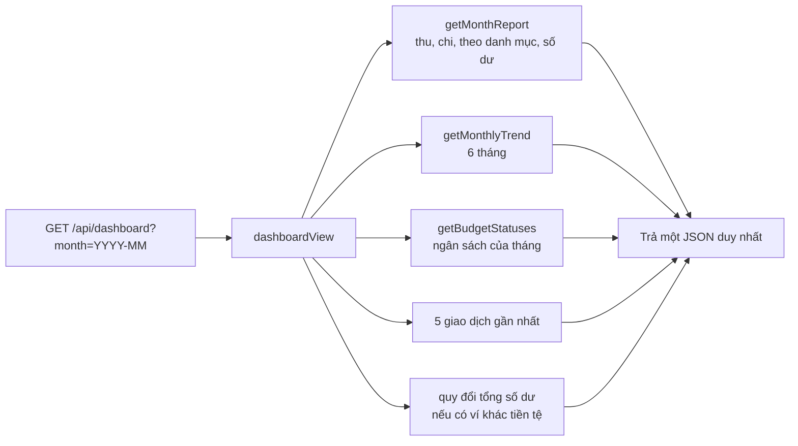

# Luồng tổng quan và báo cáo

Trang Tổng quan gom số liệu của một tháng: số dư, thu, chi, chênh lệch, chi tiêu theo danh mục, xu hướng nhiều tháng,
giao dịch gần đây và cảnh báo ngân sách. Đường đi chung của yêu cầu xem [request-flow.md](request-flow.md).

## Thành phần

| Tầng | File |
| --- | --- |
| Trang | [frontend/app/(app)/dashboard/page.tsx](../frontend/app/(app)/dashboard/page.tsx) |
| Biểu đồ | [charts.tsx](../frontend/app/(app)/dashboard/charts.tsx) (Recharts, thành phần client) |
| View (đọc) | `dashboardView` trong [backend/src/views/overview.ts](../backend/src/views/overview.ts) |
| Tính số liệu | [backend/src/data/reports.ts](../backend/src/data/reports.ts) (`getMonthReport`, `getMonthlyTrend`), [data/budgets.ts](../backend/src/data/budgets.ts) |

## Luồng

Các truy vấn chạy **song song** (`Promise.all`). Tháng lấy từ `?month=YYYY-MM`; sai thì dùng tháng hiện tại.

## Quy tắc tính

| Số liệu | Cách tính |
| --- | --- |
| **Thu nhập / Chi tiêu** | Tổng `amountInDefaultCurrency` của giao dịch `INCOME` / `EXPENSE` trong tháng |
| **Chênh lệch** | Thu − chi; nhãn "Thu nhiều hơn chi" hoặc "Chi nhiều hơn thu" |
| **Chuyển khoản** | **Không** tính là thu hay chi (chỉ chuyển tiền giữa các ví của chính bạn) |
| **Chi theo danh mục** | Chi của danh mục con **gộp vào danh mục cha**; lấy **7** danh mục lớn nhất, phần còn lại gộp thành "Khác (N danh mục)"; khoản chưa phân loại là "Chưa phân loại" |
| **Xu hướng** | Thu và chi của **6 tháng** kết thúc ở tháng đang xem, tháng không có số liệu điền 0 |
| **Số dư hiện tại** | Tổng `currentBalance` của ví chưa lưu trữ, **theo từng tiền tệ**; nếu có ví khác tiền tệ mặc định, thêm một dòng "≈ tổng quy đổi" |
| **Cảnh báo ngân sách** | Các ngân sách tháng đó ở trạng thái `near` hoặc `over` ([budget-flow.md](budget-flow.md)) |

Số liệu thu/chi dùng **bản chụp quy đổi của từng giao dịch** (tỷ giá đúng ngày giao dịch), nên một báo cáo tháng cũ không đổi khi tỷ giá hôm nay thay đổi. Số dư hiện tại thì quy đổi theo tỷ giá mới nhất ([currency-flow.md](currency-flow.md)).

**Giao dịch chưa có tỷ giá** (ngoại tệ, bản chụp còn trống) bị loại khỏi các tổng, và trang nói rõ số lượng: "N giao dịch ngoại tệ trong tháng chưa có tỷ giá quy đổi nên chưa được tính vào các số liệu trên." Loại tiền chưa có tỷ giá cũng được nêu bên cạnh tổng quy đổi.

## Giao diện

- Thẻ gradient: lời chào, nút sang tháng trước/sau (hai nút chỉ là liên kết `?month=`), số dư, ba ô Thu / Chi / Chênh lệch.
- Bốn lối tắt: Thêm giao dịch, Nhập sao kê, Ngân sách, Tiết kiệm.
- Hai biểu đồ, mỗi biểu đồ có **"Xem dạng bảng"** (bảng số liệu đầy đủ, cho người dùng trình đọc màn hình; component `ChartTable`). Biểu đồ ẩn với trình đọc màn hình (`aria-hidden`), bảng là bản thay thế. Rê chuột (hoặc chạm) vào cột hiện số tiền chính xác.
- Màu biểu đồ: xanh dương cho thu/đã chi và cam cho chi, **không** dùng xanh lá hay đỏ vì hai màu này dành cho trạng thái. Có bộ màu riêng cho giao diện tối ([ui-flow.md](ui-flow.md)).
- Trạng thái rỗng: "Chưa có khoản chi nào trong tháng này", "Chưa có giao dịch nào trong khoảng thời gian này", "Bạn chưa có tài khoản nào".

## Kiểm thử

Bộ `dashboard` (15 kiểm tra: số liệu thu/chi, gộp danh mục con, chuyển khoản không tính, xu hướng, tháng sai, cách ly người dùng), `ui` (biểu đồ và chú giải khi rê chuột).
