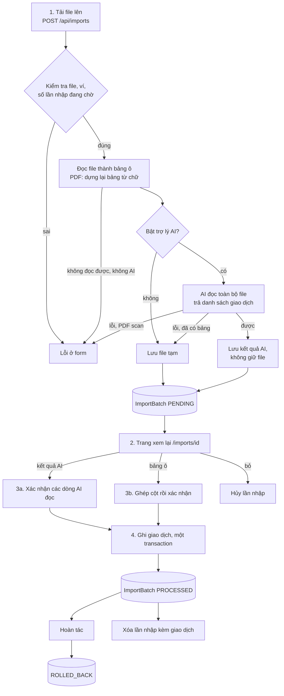
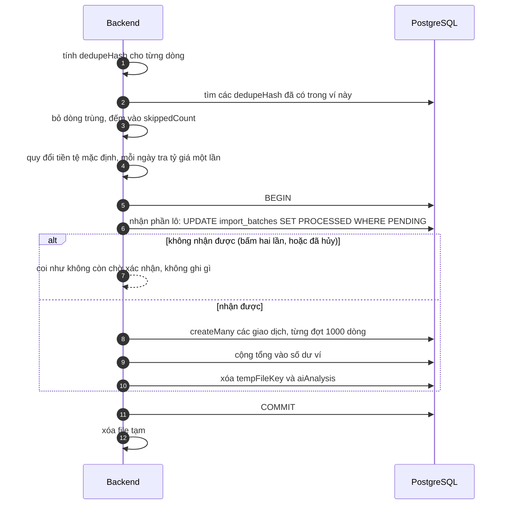

# Luồng nhập sao kê

Đưa nhiều giao dịch vào một lần từ file sao kê ngân hàng (**PDF** tải từ ngân hàng hoặc **Excel `.xlsx`**), xem lại, xác nhận, và có thể **hoàn tác** hoặc **xóa**.
Có hai đường: **không dùng AI** (app tự đọc bảng trong file, đoán cột, bạn xác nhận cách ghép) và **dùng AI** (Claude hoặc GPT đọc cả file).
File CSV không còn được nhận (từ mục 29 của [PLAN](PLAN.md)).
Đường đi chung của yêu cầu xem [request-flow.md](request-flow.md).

## Nguyên tắc thiết kế

- **Không ghi thẳng vào sổ.** Upload chỉ tạo một lần nhập chờ xác nhận (`PENDING`); giao dịch chỉ được ghi sau khi người dùng xem và bấm xác nhận.
- **Không nhập trùng.** Nhập lại cùng một file thì mọi dòng bị bỏ qua.
- **Làm lại được.** Hoàn tác cả lô, hoặc xóa lần nhập cùng giao dịch của nó.
- **Ghi một lần, trọn vẹn.** Toàn bộ lô được ghi trong một transaction database cùng với số dư ví.
- **Dữ liệu nhạy cảm không nằm lại.** File tạm và kết quả AI bị xóa khi xác nhận, hủy, hoặc sau 24 giờ bỏ dở.

## Thành phần

| Tầng | File |
| --- | --- |
| Trang | [frontend/app/(app)/imports/](../frontend/app/(app)/imports/): danh sách + form tải lên (`upload-form.tsx`); chi tiết `[id]/`: `mapping-form.tsx`, `document-form.tsx`, `row-categories.tsx`, `rollback-button.tsx`; `delete-import-button.tsx` |
| Server Action | [frontend/app/actions/imports.ts](../frontend/app/actions/imports.ts) (tải file bằng `upload()`, phần còn lại bằng `command()`) |
| Route tải file mẫu | [frontend/app/(app)/imports/template/route.ts](../frontend/app/(app)/imports/template/route.ts) |
| Handler (ghi) | [backend/src/handlers/imports.ts](../backend/src/handlers/imports.ts) |
| View (đọc) | [backend/src/views/imports.ts](../backend/src/views/imports.ts) |
| Đọc file | [imports/parse-file.ts](../backend/src/imports/parse-file.ts), [parse-pdf.ts](../backend/src/imports/parse-pdf.ts) (`pdfjs-dist`), [xlsx-guard.ts](../backend/src/imports/xlsx-guard.ts), [storage.ts](../backend/src/imports/storage.ts), [template.ts](../backend/src/imports/template.ts) (file mẫu Excel) |
| Ghép cột (không AI) | [imports/mapping.ts](../backend/src/imports/mapping.ts) |
| AI | [imports/ai.ts](../backend/src/imports/ai.ts), [imports/analysis.ts](../backend/src/imports/analysis.ts), [backend/src/ai/](../backend/src/ai/) |
| Dọn dẹp | [backend/src/maintenance.ts](../backend/src/maintenance.ts) |

## Tổng quan các bước

## 1. Tải file lên (`POST /api/imports`)

Đầu vào: ví đích, file, và ô "Dùng trợ lý AI" (chỉ hiện khi máy chủ đã cấu hình khóa AI). File đi trong **thân request** (`application/octet-stream`), tên file ở header `x-file-name`, các trường khác ở query ([lib/api/client.ts](../frontend/lib/api/client.ts) `upload`).

Kiểm tra theo thứ tự, mỗi bước sai là trả lỗi ngay ở form:

| Kiểm tra | Giới hạn / thông báo |
| --- | --- |
| Ví | Là UUID, thuộc người dùng, **chưa lưu trữ** |
| Có file | "Vui lòng chọn file sao kê." |
| Kích thước | Tối đa **5 MB** |
| Định dạng | `.pdf`, `.xlsx`; `.xls` cũ phải lưu lại thành `.xlsx`; `.csv` bị từ chối |
| PDF | Phần đầu file có dấu hiệu `%PDF-`, không đặt mật khẩu, tối đa **200 trang**; chữ đặt ngoài khung trang bị bỏ qua |
| Số lần nhập đang chờ | Tối đa **5** `PENDING` mỗi người |
| Đọc được | Đọc thành bảng; hỏng thì báo lỗi. PDF không có chữ (scan) hoặc pdf.js không mở được thì báo lỗi, **trừ khi bật AI**: khi đó file đi thẳng tới AI |

**Đọc file thành bảng ô** ([parse-file.ts](../backend/src/imports/parse-file.ts)):

- **PDF** ([parse-pdf.ts](../backend/src/imports/parse-pdf.ts)): `pdfjs-dist` lấy các mẩu chữ kèm tọa độ; app gom thành dòng theo đường chân chữ, tìm các cột từ những dòng có ngày và số tiền, nối dòng diễn giải bị xuống dòng vào giao dịch phía trên, và bỏ các dòng sau bảng không thể là giao dịch (tên cột lặp ở mỗi trang, dòng tổng, ghi chú). Chi tiết: [algorithms.md mục 8.1](algorithms.md#81-đọc-file-thành-bảng-ô). Chỉ đọc được PDF **có chữ** (sao kê tải từ ngân hàng); bản scan hay ảnh chụp thì không.
- **Excel**: lấy **sheet đầu tiên**. Trước khi mở, [xlsx-guard.ts](../backend/src/imports/xlsx-guard.ts) giải nén thử từng phần với trần **25 MB** và **1.000** mục để chặn "zip bomb": file nén nhỏ xíu nhưng bung ra hàng GB. Kích thước tự khai trong file không được tin.
- Chuẩn hóa ô: ngày, số, chuỗi; công thức lấy kết quả; chuỗi nhiều định dạng lấy văn bản thuần.
- Chỉ giữ **tối đa 50 cột**, bỏ dòng trống hoàn toàn. Tối đa **10.000 dòng**; không có dòng nào thì "File không có dữ liệu."
- "Số dòng" mà app hiển thị luôn đếm các dòng không trống, theo thứ tự trong file.

Sau đó rẽ nhánh (mục 1a hoặc 1b) rồi tạo `ImportBatch` ở trạng thái `PENDING` và chuyển tới `/imports/{id}`.

### 1a. Không dùng AI

File được lưu tạm ở `backend/storage/imports/<uuid>.pdf|xlsx` (tên là UUID, kiểm bằng biểu thức chính quy để không thể thoát khỏi thư mục), `tempFileKey` trỏ tới nó. Hiện chỉ có bảng ô, **chưa có giao dịch nào**. File `.csv` của lần nhập còn dở từ trước vẫn được dọn, nhưng không đọc lại được nữa (trang báo file tạm không còn).

### 1b. Dùng AI (xem [mục AI](#trợ-lý-ai-phân-tích-file))

Kết quả AI lưu vào `ImportBatch.aiAnalysis`; **file gốc không được giữ**. Nếu AI lỗi:
- **Excel, PDF có chữ**: vẫn tạo lần nhập, chuyển sang ghép cột tay trên bảng app đã đọc (có thông báo "Trợ lý AI không đọc được file này, nên bạn cần tự ghép cột bên dưới.").
- **PDF scan** (app không đọc được chữ): báo lỗi và **không** tạo lần nhập (không còn cách nào khác để đọc nó).

## 2. Trang xem lại (`GET /api/imports/:id`)

`importView` trả `{ batch, pending }`. Trang hiện khác nhau tùy trạng thái:

| Trạng thái | Trang hiện |
| --- | --- |
| `PENDING`, có kết quả AI | **Bảng giao dịch AI đọc được**: ngày, số tiền, loại, diễn giải, ô chọn danh mục cho từng dòng (tối đa **100 dòng đầu**), cùng danh sách dòng AI đọc không được |
| `PENDING`, không AI | **Xem trước 20 dòng đầu** của file và **form ghép cột** điền sẵn theo gợi ý (mục dưới) |
| `PENDING`, file tạm đã mất | Chỉ có nút hủy |
| `PROCESSED`, `ROLLED_BACK` | Kết quả: số dòng đã nhập, bỏ qua vì trùng, dòng lỗi (kèm lý do), liên kết xem giao dịch |

### Gợi ý ghép cột: vì sao không cần AI

[`suggestMapping`](../backend/src/imports/mapping.ts) là một **bộ luật cố định**, không hiểu nội dung file mà chỉ so **tên cột** với từ điển các tên quen thuộc của sao kê Việt Nam và quốc tế:

| Trường | Tên nhận ra (sau khi bỏ dấu, chữ thường) |
| --- | --- |
| Ngày | ngày, date, ngày gd, ngày giao dịch, transaction date, ngày hạch toán, posting date |
| Số tiền (một cột có dấu) | số tiền, amount, số tiền gd, số tiền giao dịch |
| Tiền ra | nợ, debit, ghi nợ, số tiền ghi nợ, phát sinh nợ, rút, chi, withdrawal |
| Tiền vào | có, credit, ghi có, số tiền ghi có, phát sinh có, gửi, thu, deposit |
| Diễn giải | diễn giải, nội dung, nội dung giao dịch, description, narrative, mô tả, details, remark |

Cách làm:

1. **Chuẩn hóa tiêu đề**: chữ thường, bỏ dấu, `đ` thành `d`, ký tự đặc biệt thành khoảng trắng. `"Số tiền ghi nợ (VND)"` thành `"so tien ghi no vnd"`.
2. **Chấm điểm**: khớp hoàn toàn được `100 + độ dài`; chỉ *chứa* (so trọn từ) được điểm bằng độ dài. Tên **dài hơn thắng**, nên "so tien ghi no" vào cột tiền ra chứ không vào cột "số tiền" chung.
3. **Tìm dòng tiêu đề**: trong 30 dòng đầu, dòng nhận ra được nhiều loại cột nhất. Nhờ đó bỏ qua phần đầu file (tên ngân hàng, số tài khoản…).
4. Có cả cột tiền ra và tiền vào (khác nhau) → chế độ **hai cột**; không thì **một cột có dấu** (âm là chi).
5. Suy thêm từ **20 dòng dữ liệu**: định dạng ngày (có giá trị bắt đầu bằng 4 chữ số là `YMD`; phần thứ hai lớn hơn 12 là `MDY`; còn lại `DMY`) và dấu thập phân (có số kết thúc bằng `,xx` thì dấu phẩy).

**Giới hạn**: chỉ nhận ra tiêu đề có trong từ điển (cột "Biến động" thì không; không thấy cột ngày thì mặc định cột đầu), và không nhìn vào giá trị trong ô để đoán loại cột. Vì thế nó chỉ là **gợi ý điền sẵn**: người dùng sửa lại, và `buildRows` kiểm từng dòng khi xác nhận. Ghép sai thì báo không đọc được dòng nào kèm lý do, chứ không ghi dữ liệu sai. File mẫu tải về dùng đúng tên cột trong từ điển ("Ngày giao dịch", "Diễn giải", "Số tiền") nên không cần ghép tay.

## 3a. Xác nhận khi ghép cột tay (`POST /api/imports/:id/confirm`)

Đầu vào: dòng tiêu đề, cột ngày, định dạng ngày, kiểu cột số tiền, cột số tiền hoặc cột tiền ra + tiền vào, cột diễn giải (tùy chọn), dấu thập phân, danh mục mặc định cho khoản chi và khoản thu. Zod kiểm: cột trong 0–49, kiểu một cột phải có cột số tiền, kiểu hai cột phải có cả hai và hai cột phải khác nhau.

1. Lần nhập phải còn `PENDING`, có file tạm, và ví chưa lưu trữ.
2. Đọc lại **toàn bộ** file tạm (không chỉ phần xem trước).
3. [`buildRows`](../backend/src/imports/mapping.ts) đọc từng dòng sau dòng tiêu đề:
   - **Ngày** theo định dạng đã chọn; bỏ phần giờ; năm hai chữ số thành 20xx; chỉ nhận 2000–2100.
   - **Số tiền**: bỏ ký hiệu tiền tệ và khoảng trắng, nhận `(1,200.50)` là âm, hiểu `1.500.000 VND`; bỏ dấu ngàn theo dấu thập phân đã chọn. Cố ý **không làm tròn**: "1.500" đọc nhầm dấu phải **báo lỗi**, không lặng lẽ thành 1,50.
   - **Chiều thu/chi**: một cột thì số âm là chi, dương là thu; hai cột thì có tiền ra là chi, có tiền vào là thu, có cả hai hoặc không có cái nào là dòng lỗi.
   - Diễn giải gọn về một dòng, tối đa 200 ký tự.
4. Dòng lỗi **không làm hỏng cả lô**: được gom lại kèm lý do và số dòng, các dòng còn lại vẫn nhập. Nếu **không đọc được dòng nào**: "Không đọc được dòng giao dịch nào với cách ghép cột này…" kèm lý do, **không ghi gì**.
5. Chuyển sang bước ghi (mục 4). Cột ghép được lưu vào `columnMapping` để dò lỗi sau này.

## 3b. Xác nhận khi AI đọc (`POST /api/imports/:id/confirm-document`)

Các dòng đã được AI đọc từ lúc tải lên, nên người dùng chỉ chọn **danh mục mặc định** (chi, thu) và có thể chỉnh danh mục từng dòng (`rowCategory-<số dòng>`, tối đa 500 dòng, 100 dòng đầu có ô chọn). Thứ tự ưu tiên danh mục của một dòng:

1. Lựa chọn của người dùng cho dòng đó (rỗng nghĩa là "dùng mặc định", **cả khi AI có gợi ý**);
2. Gợi ý của AI;
3. Danh mục mặc định theo loại.

Chỉ nhận danh mục người dùng được dùng và **đúng loại** của dòng; sai thì rơi về mặc định. Sau đó sang bước ghi.

## 4. Ghi giao dịch (`writeImport`)

- **Chống trùng**: `dedupeHash = sha256(ví | ngày | số tiền có dấu | diễn giải chữ thường | số thứ tự lần xuất hiện)`. Số thứ tự cho phép hai khoản **giống hệt nhau trong cùng ngày** (hai ly cà phê cùng giá) cùng được giữ, nhưng nhập lại cả file thì mọi dòng đều trùng và bị bỏ qua. Ghi nhận bỏ qua ở `skippedCount`, hiển thị "Bỏ qua vì trùng".
- **Nhận lô trước khi ghi**: câu `UPDATE … WHERE status = 'PENDING'` biến bấm xác nhận hai lần thành thao tác vô hại (lần sau không nhận được lô và không ghi gì).
- Mỗi giao dịch có `source = IMPORT`, `importBatchId`, `dedupeHash`, ghi chú là diễn giải, và **cùng một giá trị `createdAt` và `updatedAt`**: hoàn tác dựa vào đó để biết giao dịch có bị sửa tay sau này không.
- Giao dịch được quy đổi về tiền tệ mặc định như mọi giao dịch khác ([currency-flow.md](currency-flow.md)).

## 5. Hủy, hoàn tác, xóa

| Thao tác | Khi nào | Việc làm |
| --- | --- | --- |
| **Hủy** (`/cancel`) | Lần nhập còn `PENDING` | Xóa lần nhập và file tạm. Chưa có giao dịch nào để dọn |
| **Hoàn tác** (`/rollback`) | Lần nhập `PROCESSED` | Trong một transaction có khóa dòng: xóa giao dịch của lô, **trả lại số dư** ví, đánh dấu `ROLLED_BACK`. **Từ chối** nếu có giao dịch đã bị sửa tay (`updatedAt` khác `createdAt`): "Có N giao dịch trong lần nhập này đã được sửa tay nên không hoàn tác được cả lô." |
| **Xóa** (`DELETE /imports/:id`) | Mọi trạng thái | Xóa lần nhập, file tạm **và mọi giao dịch của nó, kể cả đã sửa tay**, trả lại số dư. Không hoàn tác được. Có modal xác nhận nêu rõ số giao dịch sẽ mất |

Hoàn tác và xóa khóa dòng (`FOR UPDATE`) lô và các giao dịch của nó, nên một thao tác xác nhận đang chạy song song phải chờ rồi thấy không còn gì để làm.

## Trợ lý AI phân tích file

Khi bật, mô hình AI đọc **toàn bộ file** và trả danh sách giao dịch; không còn bước ghép cột. Nhà cung cấp (Claude hoặc OpenAI) và cấu hình xem [README](../README.md#cau-hinh); lớp dùng chung ở [backend/src/ai/](../backend/src/ai/).

- **Excel**: mọi dòng được gửi đi, chia thành các phần **150 dòng** (4 phần chạy song song). Từ phần thứ hai, **15 dòng đầu** của file được gửi kèm để AI luôn thấy tiêu đề cột. Mỗi giao dịch AI trả về có **số dòng gốc**; dòng ngoài phần đang đọc hoặc bị lặp bị bỏ. **Một phần lỗi thì cả file coi như lỗi**, không nhập nửa chừng (nếu không sẽ mất giao dịch trong im lặng).
- **PDF**: nguyên file gửi trong **một** lệnh gọi (AI thấy cả bố cục, không phải bảng app dựng lại); dài quá giới hạn câu trả lời thì từ chối kèm gợi ý tách file, hoặc chuyển sang ghép cột tay nếu app đã đọc được bảng.
- Excel trên **3.000 dòng** không gửi cho AI (quá nhiều lệnh gọi) mà chuyển sang ghép cột tay.
- **Kết quả**: ngày, loại thu/chi, số tiền, diễn giải và gợi ý danh mục cho từng giao dịch, theo một JSON schema cố định.
- **Server kiểm tra lại từng giá trị**: ngày có thật không, số tiền hợp lệ không; dòng hỏng vào danh sách lỗi; danh mục sai loại hoặc ngoài danh sách bị bỏ.
- **Nội dung file là dữ liệu không tin cậy**: prompt dặn AI không coi nội dung file là chỉ dẫn, và câu trả lời bị ràng buộc bằng schema.
- **Rủi ro chính**: ngày và số tiền do AI đọc, không phải code đọc từ ô. Vì vậy trang xem lại liệt kê giao dịch và yêu cầu **đối chiếu với sao kê** trước khi ghi. Ai cần số liệu do code đọc thì bỏ chọn trợ lý AI và tự ghép cột.

**Giới hạn chi phí**: mỗi người tối đa **20 lần phân tích mỗi giờ**; mỗi lệnh gọi AI bị chặn khi đã hết **hạn mức token trong ngày** (của cả hệ thống hoặc của người dùng): "Trợ lý AI đã dùng hết hạn mức hôm nay." Bộ đếm nằm ở bảng `rate_limits` ([security-flow.md](security-flow.md)).

**Quyền riêng tư**: nội dung file được gửi tới nhà cung cấp AI đang dùng (trang tải lên ghi rõ tên); với OpenAI request đặt `store: false`. Nội dung file không được ghi log.

## Dọn dẹp tự động ([maintenance.ts](../backend/src/maintenance.ts))

Chạy sau khi backend khởi động rồi mỗi giờ (`MAINTENANCE_INTERVAL_MS`):

- Lần nhập `PENDING` quá **24 giờ** bị xóa cùng file tạm.
- File trong `backend/storage/imports` không thuộc lần nhập nào và cũ hơn 24 giờ cũng bị xóa (sót lại do sự cố).
- Bộ đếm giới hạn cũ hơn 2 ngày bị xóa.

## Trạng thái lần nhập

`PENDING` → `PROCESSED` → `ROLLED_BACK`. (`FAILED` có trong kiểu dữ liệu nhưng hiện chưa được dùng: lỗi khi nhập được báo ngay ở form chứ không tạo lần nhập hỏng.)

## Trường hợp lỗi thường gặp

| Tình huống | Kết quả |
| --- | --- |
| File quá 5 MB, sai định dạng, hỏng, quá 10.000 dòng | Lỗi ở trường file |
| Excel bung ra quá 25 MB | "File Excel quá lớn khi giải nén. Hãy tách thành nhiều file nhỏ hơn." |
| PDF có mật khẩu | "File PDF có mật khẩu. Hãy tải sao kê không đặt mật khẩu…" |
| PDF quá 200 trang | "File PDF có hơn 200 trang. Hãy tải sao kê theo khoảng thời gian ngắn hơn." |
| PDF scan, không bật AI | "File PDF không có chữ để đọc (có thể là bản scan hoặc ảnh chụp)…" |
| File `.csv` | "Chỉ hỗ trợ file .pdf và .xlsx…" |
| Đang có 5 lần nhập chờ | "Bạn đang có N lần nhập chưa hoàn tất. Hãy xác nhận hoặc hủy bớt…" |
| Vượt 20 lần AI mỗi giờ, hết hạn mức token | Lỗi chung, kèm gợi ý bỏ chọn AI để ghép cột tay |
| Xác nhận lần nhập không còn chờ (bấm hai lần, đã hủy) | "Lần nhập này không còn chờ xác nhận." |
| File tạm đã bị dọn | "File tạm đã bị xóa. Hãy hủy lần nhập này và tải file lên lại." |

## Kiểm thử

| Bộ | Nội dung |
| --- | --- |
| `imports` (75) | PDF (cột nợ/có, một cột có dấu, diễn giải xuống dòng, nhiều trang, mật khẩu, scan, chữ đặt ngoài trang, sao kê do chính app xuất), Excel, CSV bị từ chối, ghép cột, chống trùng, hoàn tác, xóa lần nhập, "zip bomb", dọn lần nhập bỏ dở |
| `imports-ai` (52, chạy cả với Claude lẫn OpenAI) | AI đọc Excel/PDF qua máy chủ giả, chia phần, lỗi, PDF có chữ chuyển sang ghép cột tay khi AI lỗi, hạn mức |
| `import-templates` (6) | File mẫu Excel |
