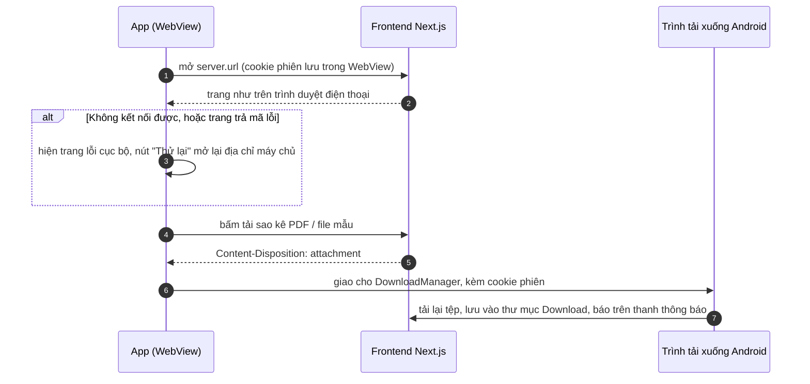

# Ứng dụng Android (Capacitor)

App Android là một **vỏ native quanh chính trang web**: mở một WebView tới địa chỉ của frontend Next.js. Không có giao diện
hay nghiệp vụ riêng, nên mọi thay đổi của trang web có ngay trong app mà **không cần build lại** (chỉ build lại khi đổi địa
chỉ máy chủ hoặc phần native). Đường đi của yêu cầu sau khi trang đã mở giống hệt trình duyệt: [request-flow.md](request-flow.md).

## Thành phần

| Phần | File |
| --- | --- |
| Gói npm `@fm/mobile` (Capacitor 8) | [mobile/package.json](../mobile/package.json) |
| Cấu hình: địa chỉ máy chủ, tên app, trang lỗi | [mobile/capacitor.config.ts](../mobile/capacitor.config.ts) |
| Trang hiện khi không mở được trang web | [mobile/error-page.html](../mobile/error-page.html) (chép thành `mobile/www/index.html` mỗi lần sync, không commit) |
| Project Android (Gradle) | [mobile/android/](../mobile/android/) |
| Nút Back, tải tệp, giữ phiên khi tắt app | [MainActivity.java](../mobile/android/app/src/main/java/io/github/copirlo20/financialmanagement/MainActivity.java) |
| Màu thanh hệ thống theo trang, màn hình chờ khi mở app | [SystemBarsColorPlugin.java](../mobile/android/app/src/main/java/io/github/copirlo20/financialmanagement/SystemBarsColorPlugin.java), chạy script [res/raw/system_bars.js](../mobile/android/app/src/main/res/raw/system_bars.js) sau mỗi lần tải trang |
| Biểu tượng app, màn hình chờ (vector, không PNG) | `res/drawable/ic_launcher_background.xml`, `res/drawable-v24/ic_launcher_foreground.xml`, `res/mipmap-anydpi*/`, `res/drawable/splash.xml`, `res/values/colors.xml`, `res/values-v31/styles.xml` |
| Câu thông báo (tiếng Anh / tiếng Việt) | `res/values/strings.xml`, `res/values-vi/strings.xml` |
| Địa chỉ LAN của máy (dùng chung với `npm run dev`) | [scripts/network.mjs](../scripts/network.mjs) |

## Địa chỉ máy chủ

Địa chỉ được **ghi cố định vào app lúc chạy `npm run mobile:sync`**, theo thứ tự:

1. `MOBILE_SERVER_URL` trong biến môi trường hoặc trong `.env` ở thư mục gốc (chỉ nhận `http://` hoặc `https://`, lấy phần gốc
   `scheme://host:port`). Dùng cho bản thật, ví dụ `https://finance.example.com`.
2. Không đặt thì lấy **địa chỉ Wi-Fi/Ethernet của máy đang chạy lệnh** (bỏ qua card mạng ảo) với cổng `PORT` (mặc định 3000),
   ví dụ `http://192.168.0.240:3000`: điện thoại mở `npm run dev` của máy này qua mạng nội bộ.

Địa chỉ `http://` thì app bật `cleartext` (Android mặc định chặn HTTP thường). Đổi mạng Wi-Fi hoặc máy nhận IP khác thì chạy lại
`npm run mobile:sync` và cài lại app.

## Luồng



- **Đăng nhập:** cookie `httpOnly` nằm trong kho cookie của WebView, giữ qua các lần mở app như trên trình duyệt. WebView chỉ ghi
  cookie xuống bộ nhớ khoảng nửa phút một lần, nên `MainActivity` ghi ngay (`CookieManager.flush()`) mỗi khi app rời màn hình:
  đăng nhập xong rồi vuốt tắt app ngay vẫn còn phiên.
- **Nút Back** quay về trang trước; ở trang đầu tiên mới thoát app (không cần plugin `@capacitor/app`; chạy cả với cử chỉ Back
  dự đoán của Android 16+). Chromium **bỏ qua** khi Back các trang mà script tự chuyển tới không do người bấm, nên kiểm thử phải
  chạm thật (`adb shell input tap`), không đặt `location.href`.
- **Tải tệp:** WebView không tự lưu tệp, nên `MainActivity` giao cho trình tải xuống của Android. Trình tải xuống gửi lại yêu cầu,
  nên một lần tải sao kê trong app tính **hai lần** vào giới hạn 30 lần/giờ ([statement-flow.md](statement-flow.md)).
  Android 9 trở xuống cần quyền ghi bộ nhớ mà app không xin, nên app báo "Không lưu được tệp". Câu thông báo ("Đang tải …") theo
  **ngôn ngữ chọn trong app** (cookie `locale` của trang, mặc định tiếng Việt), không theo ngôn ngữ của điện thoại.
- **Chọn tệp** khi nhập sao kê dùng bộ chọn tệp của Android (Capacitor có sẵn).
- **Thanh hệ thống:** Capacitor chừa khoảng cho thanh trạng thái và thanh điều hướng (`SystemBars.insetsHandling: "native"`;
  mặc định `"css"` ghi biến `--safe-area-inset-*` lên `<html>` trước khi React chạy, gây cảnh báo hydration). Trang web dùng
  `env(safe-area-inset-*)` như trên trình duyệt. Hai thanh **lấy màu ở mép trên của trang** (đổi theo giao diện sáng/tối và khi
  chuyển trang), biểu tượng sáng hoặc tối cho dễ đọc: sau mỗi lần tải trang, plugin chạy `system_bars.js`, script này đọc màu
  (qua canvas, nên màu `oklch` hay trong suốt đều đổi được ra RGB) và gửi cho plugin `SystemBarsColor` qua cầu nối Capacitor.
- **Mở app:** logo ví trắng trên nền tím của thương hiệu, giữ nguyên tới khi trang vẽ xong (WebView trong suốt) thay vì nháy trắng.
- **Trang lỗi** hiện thay cho mọi trang tải hỏng: mất mạng, máy chủ tắt, và cả mã lỗi HTTP (ví dụ 404), vì Capacitor không phân biệt.
  Nội dung viết chung cho cả hai trường hợp, theo ngôn ngữ của điện thoại.

## Build và cài

Cần **Android SDK** (cài cùng Android Studio). Project dùng Gradle **9.1** (wrapper đã nâng từ 8.14 của mẫu Capacitor), chạy được
với JDK 25 (JDK của máy và của Android Studio đều là 25; Gradle 8.14 thì không). Lần đầu tạo `mobile/android/local.properties`
(không commit) trỏ tới SDK: `sdk.dir=C:/Users/<tên>/AppData/Local/Android/Sdk`, hoặc mở project bằng Android Studio để nó tự tạo.

```bash
npm run dev                                  # máy chủ cho app dùng (hoặc đặt MOBILE_SERVER_URL tới bản đã triển khai)
npm run mobile:run                           # sync, build bản debug, cài và mở trên máy ảo/điện thoại đang cắm (hỏi chọn máy)
npm run mobile:run -- --target emulator-5554 # chọn sẵn máy
npm run mobile:open                          # hoặc mở mobile/android trong Android Studio rồi bấm Run
```

File APK bản debug: `mobile/android/app/build/outputs/apk/debug/app-debug.apk` (cài thẳng lên điện thoại được).

- Điện thoại và máy tính phải **cùng mạng Wi-Fi**, Node.js được phép qua tường lửa (như khi mở trang web từ điện thoại).
- Máy ảo Android cũng dùng được địa chỉ LAN của máy tính.
- Bản production chạy bằng `npm start` đặt cookie `Secure`, nên **chỉ đăng nhập được qua HTTPS**: phát hành app thì triển khai
  trang web có HTTPS và đặt `MOBILE_SERVER_URL`. Bản `npm run dev` qua HTTP vẫn đăng nhập được.
- Phát hành lên Google Play cần ký bản release (Android Studio → Build → Generate Signed Bundle). `appId`
  `io.github.copirlo20.financialmanagement` không đổi được sau khi đã phát hành.

- Khi phát triển (`npm run dev`), kết nối nạp lại trực tiếp của Next.js (`/_next/hmr`) từng rơi vào vòng **kết nối lại mỗi giây
  mãi mãi**, và khi đó chuyển trang kẹt ở "Rendering…" dù dữ liệu trang đã về (backend đã trả lời). Lỗi nằm ở Next.js (16.3, cả
  16.4.2): khi mở kết nối mới nó đóng kết nối cũ nhưng để nguyên `onclose`, nên lần đóng đó bị coi là mất kết nối và hẹn thêm một
  lần kết nối lại, lần này lại đóng kết nối kế tiếp… Chỉ cần hai lần kết nối lại chồng nhau một lần (app quay lại từ nền đúng lúc
  đang kết nối lại, mạng chập chờn) là vòng lặp bắt đầu; trên điện thoại điều này xảy ra thường xuyên. `frontend/instrumentation-client.ts`
  gỡ `onclose`/`onerror` của kết nối HMR mà trang tự đóng (đúng điều Next.js làm khi đóng sau một lần mất kết nối thật), chỉ trong
  chế độ phát triển. Đã thử A/B trên máy ảo: không vá thì 10 lần kết nối lại trong 10 giây và không dừng; có vá thì 1 lần rồi ổn định.
  Bản production (`next start`) không có HMR nên không bị.

**Đã chạy thử** trên máy ảo Android 17 (API 37, `Medium_Phone`): đăng ký, nút Back (cả ở trang đầu), tải sao kê PDF vào
Download, trang lỗi và nút Thử lại, giữ phiên sau khi vuốt tắt app, chọn PDF bằng bộ chọn tệp của Android rồi nhập sao kê,
giao diện tối và màu thanh hệ thống, màn hình chờ, biểu tượng.

## Chưa làm

- **iOS:** cần máy Mac có Xcode (`npx cap add ios` trong `mobile/`). Apple có thể từ chối app chỉ bọc trang web
  (App Store Review Guideline 4.2) nếu không có thêm tính năng native.
- Chạy khi không có mạng: app cần máy chủ cho mọi trang, vì trang dựng ở server (Server Components) và dữ liệu nằm ở backend.
