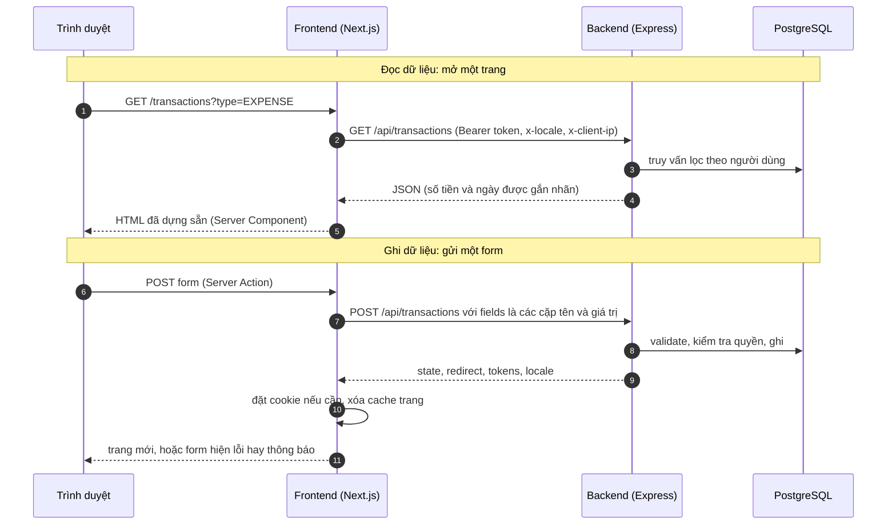

# Luồng chung của mọi yêu cầu

Mọi chức năng khác đều đi qua cùng một đường: **trình duyệt → frontend (Next.js) → backend (Express) → database**.
Hiểu đường này một lần là đọc được mọi luồng còn lại. Xem thêm [STRUCTURE.md](STRUCTURE.md) về thư mục.

## Nguyên tắc

- Trình duyệt **chỉ nói chuyện với frontend**. Frontend gọi backend ở phía server, nên token đăng nhập nằm trong cookie `httpOnly`, không cần CORS và JavaScript của trang không đọc được token.
- Frontend **không chạm database và không giữ bí mật**; nó chỉ biết `BACKEND_URL`. Backend mặc định chỉ nghe ở `127.0.0.1`.
- Backend là nơi **duy nhất** kiểm tra quyền và validate (Zod). Giao diện ẩn/hiện theo vai trò chỉ để cho gọn, mọi route tự kiểm tra lại.

## Hai loại yêu cầu

### Đọc (`view`)

1. Trang là **Server Component**: gọi `apiLoad` hoặc `apiGet` ([frontend/lib/api/client.ts](../frontend/lib/api/client.ts)) tới `GET /api/...`.
2. Backend chạy một hàm `…View()` trong [backend/src/views/](../backend/src/views/) và trả JSON. Hàm trả `null` nghĩa là "không có (hoặc không phải của bạn)" → `404` → trang hiện "Không tìm thấy".
3. `401` (hết phiên) → frontend chuyển về `/login`.

### Ghi (`command`)

1. Form gọi một **Server Action** trong [frontend/app/actions/](../frontend/app/actions/). Action chỉ chuyển form nguyên vẹn sang `command("POST", "/accounts", formData)`; nghiệp vụ không nằm ở frontend.
2. Body gửi đi là `{ "fields": [["name", "Vietcombank"], ...] }`. Backend ([http/routing.ts](../backend/src/http/routing.ts)) dựng lại thành `FormData` và gọi hàm trong [handlers/](../backend/src/handlers/).
3. Handler trả về **trạng thái của form** (`FormState`), luôn với HTTP `200`:

| Kết quả của handler | Hiển thị |
| --- | --- |
| `{ success: true }` | Form được xóa trắng, hiện thông báo thành công |
| `{ errors: { name: ["…"] }, values }` | Lỗi từng trường, giữ nguyên những gì người dùng đã gõ |
| `{ message: "…", values }` | Lỗi chung của cả form (ví dụ vượt giới hạn) |
| `redirect("/accounts")` | Chuyển sang trang khác |
| `setSessionTokens(…)` | Frontend lưu cặp token vào cookie (đăng nhập) hoặc xóa cookie (`null`, đăng xuất) |
| `setLocale("en")` | Frontend nhớ ngôn ngữ trong cookie |

4. Sau mỗi lệnh ghi, frontend gọi `revalidatePath("/", "layout")` để bỏ các trang đã lưu đệm (số liệu có thể đã đổi), rồi mới chuyển trang.

## Ngữ cảnh của một yêu cầu

Mỗi yêu cầu vào backend được bọc trong một ngữ cảnh ([http/context.ts](../backend/src/http/context.ts), dùng `AsyncLocalStorage`) gồm:

| Trường | Lấy từ đâu | Dùng để |
| --- | --- | --- |
| `user`, `sessionId` | Token trong header `Authorization`, **kiểm lại với database** | Biết ai đang gọi |
| `locale` | Header `x-locale` | Dịch thông báo (`vi` hoặc `en`) |
| `clientIp` | Header `x-client-ip` (frontend lấy từ `X-Forwarded-For`) | Giới hạn theo địa chỉ |
| `refreshToken` | Header `x-refresh-token`, chỉ khi đăng xuất | Biết phiên nào cần kết thúc |
| `effects` | Handler ghi vào | Tokens, locale gửi ngược cho frontend |

Mọi view và handler **cần đăng nhập** bắt đầu bằng `requireUser()` (hoặc `requireAdmin()`): không có người dùng thì `401`; admin route gọi bởi người thường thì `404`. Chỉ vài route công khai không cần: đăng ký, đăng nhập, đăng xuất, làm mới token, đổi ngôn ngữ và kiểm tra sức khỏe (`/api/health`).

## Quy ước dữ liệu qua đường truyền

- **Số tiền** là `Decimal` đầu-cuối: trong form là chuỗi, trong JSON là `{"$decimal": "1250000.50"}`, frontend khôi phục bằng `decimal.js`. Không bao giờ qua số thực.
- **Ngày** trong JSON là `{"$date": "…"}`; cột `DATE` lưu ở 00:00 UTC; ngày trong form là `dd/mm/yyyy` như hiển thị (backend nhận cả `YYYY-MM-DD` và chuyển về dạng này trước khi kiểm), tháng là `YYYY-MM`.
- **Id** là UUID. Id sai và id của người khác cho cùng một kết quả (đọc → `404`, ghi → "Không tìm thấy …") để không lộ id có tồn tại hay không.

## Đa ngôn ngữ

Câu **tiếng Việt là khóa dịch** ([shared/src/i18n/](../shared/src/i18n/)): tiếng Việt hiện nguyên, tiếng Anh tra trong `en.ts`, câu chưa dịch rơi về tiếng Việt. Chỗ có số liệu dùng `{0}`, `{1}`. Backend dịch các thông báo lỗi của nó theo header `x-locale`. Xem [ui-flow.md](ui-flow.md).

## Lỗi

| Mã | Khi nào | Frontend làm gì |
| --- | --- | --- |
| `401` | Thiếu token, token sai, phiên đã bị kết thúc, tài khoản bị khóa | Chuyển về `/login` |
| `404` | Không có bản ghi, không phải của bạn, admin route gọi bởi người thường | Trang "Không tìm thấy" |
| `429` | Quá giới hạn (chat) | Thông báo trong khung chat |
| `5xx` | Lỗi không lường trước (chi tiết chỉ ở log backend) | Trang "Đã xảy ra lỗi" kèm nút Thử lại |
| Không kết nối được backend | Backend đang khởi động lại (nạp lại khi sửa mã, triển khai) hoặc đã dừng | Frontend **chờ và thử lại** khoảng 5 giây (với "connection refused" — yêu cầu chưa tới backend nên thử lại an toàn, kể cả khi ghi; và với kết nối bị cắt giữa chừng (`ECONNRESET`, `UND_ERR_SOCKET`) **chỉ khi là yêu cầu đọc GET/HEAD**, vì yêu cầu ghi có thể đã được xử lý); vẫn không được thì log ghi `Backend not reachable at …`; trang đang mở hiện "Đã xảy ra lỗi", còn form có trạng thái (`formCommand`/`formUpload`) thì báo ngay trên form "Không kết nối được máy chủ nên chưa có gì thay đổi" và giữ dữ liệu đã nhập (trừ mật khẩu). Lệnh ghi bị cắt giữa chừng **không** được gửi lại; form báo "Mất kết nối tới máy chủ khi đang lưu… hãy kiểm tra lại trước khi gửi lại" (các nút bấm như Xóa vẫn ra trang lỗi). Khi chạy `npm run dev`, backend crash lúc đang phục vụ được [scripts/dev.mjs](../scripts/dev.mjs) **tự chạy lại** (tối đa 3 lần/phút; `node --watch` tự nó chỉ chờ file đổi). Người dùng **không bị đăng xuất** |

## Khi người dùng bấm Quay lại hoặc điều hướng

Giao diện dựng lớp phủ chờ (skeleton) khi trang đến chậm hơn 150 ms; xem [ui-flow.md](ui-flow.md).

## Kiểm thử

Các bộ `auth`, `states`, `ui` kiểm tra đường truyền này (chuyển hướng, 401, 404, trạng thái lỗi). Mọi bộ khác dùng nó như một phần của luồng của mình.
