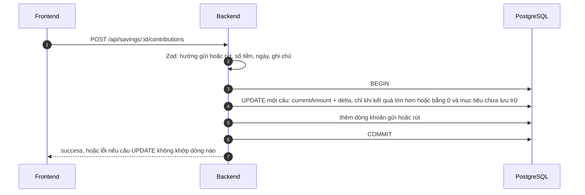

# Luồng mục tiêu tiết kiệm

Đặt mục tiêu (số tiền, hạn chót), gửi hoặc rút từng khoản và theo dõi tiến độ. Mục tiêu tiết kiệm **độc lập với ví**: gửi hay rút
ở đây không tạo giao dịch và không đổi số dư ví. Đường đi chung của yêu cầu xem [request-flow.md](request-flow.md).

## Thành phần

| Tầng | File |
| --- | --- |
| Trang | [frontend/app/(app)/savings/](../frontend/app/(app)/savings/) (danh sách, form tạo, chi tiết `[id]`, sửa `[id]/edit`) |
| Hiển thị tiến độ | [goal-progress.tsx](../frontend/app/(app)/savings/goal-progress.tsx), [frontend/lib/savings.ts](../frontend/lib/savings.ts) |
| Server Action | [frontend/app/actions/savings.ts](../frontend/app/actions/savings.ts) |
| Handler (ghi) | [backend/src/handlers/savings.ts](../backend/src/handlers/savings.ts) |
| View (đọc) | [backend/src/views/savings.ts](../backend/src/views/savings.ts) |
| Luật nhập liệu | [backend/src/validations/savings.ts](../backend/src/validations/savings.ts) |

## Dữ liệu

- `savings_goals`: `name`, `targetAmount`, `currentAmount` (**số đã tiết kiệm, lưu sẵn**), `currency`, `deadline` (tùy chọn), `status` (`IN_PROGRESS`, `COMPLETED`, `ARCHIVED`).
- `savings_contributions`: từng khoản `amount` (**gửi dương, rút âm**), `date`, `note`.

## Tạo mục tiêu

1. Zod: tên (1–60 ký tự), số tiền mục tiêu (dương), tiền tệ, hạn chót (rỗng = không có).
2. Tên **không trùng** (không phân biệt hoa thường). Tối đa **50** mục tiêu mỗi người.
3. Tạo xong chuyển thẳng tới trang chi tiết của mục tiêu.

## Gửi và rút

Điểm quan trọng nằm ở **một câu lệnh SQL** cập nhật `currentAmount` và **suy ra lại trạng thái** cùng lúc:

- `currentAmount ≥ targetAmount` → `COMPLETED`; ngược lại `IN_PROGRESS`; mục tiêu đã `ARCHIVED` giữ nguyên.
- Điều kiện `currentAmount + delta ≥ 0` nằm trong chính câu lệnh, nên **không rút quá số đã có**, và hai khoản gửi cùng lúc không làm mất cập nhật nào.

## Xóa một khoản

Xóa dòng trước rồi hoàn lại `currentAmount`. Nếu việc hoàn làm tổng **âm** (khoản gửi đó đã được rút đi ở các lần sau) thì bị từ chối: "Không xóa được: số tiền này đã được rút ra ở các lần sau. Hãy xóa lần rút trước." Hai lần xóa đồng thời: lần sau không thấy gì để xóa nên không hoàn hai lần.

## Sửa, lưu trữ, xóa

| Thao tác | Quy tắc |
| --- | --- |
| **Sửa** | Đổi tên, số tiền mục tiêu, hạn chót; **không đổi tiền tệ**. Trạng thái tính lại cùng câu lệnh (đổi mục tiêu có thể hoàn thành hoặc mở lại). |
| **Lưu trữ** | Chuyển `ARCHIVED`; **không ghi thêm** khoản nào cho tới khi khôi phục. |
| **Khôi phục** | Trả về `COMPLETED` hoặc `IN_PROGRESS` tùy `currentAmount` so với mục tiêu. |
| **Xóa** | Xóa mục tiêu **kèm toàn bộ lịch sử** (khóa ngoại `CASCADE`). Có modal xác nhận. |

## Hiển thị tiến độ

Trang chi tiết hiện thanh tiến độ, phần trăm, "Còn thiếu …" và 100 khoản gần nhất. Nếu mục tiêu có hạn chót và đang `IN_PROGRESS`, tính **gợi ý mỗi tháng** ([lib/savings.ts](../frontend/lib/savings.ts)):

- Quá hạn: "Đã quá hạn N ngày".
- Còn hạn: số tháng còn lại **làm tròn lên** (mỗi 30 ngày, tối thiểu 1), gợi ý = số còn thiếu / số tháng, làm tròn **lên** 2 chữ số thập phân, nên không bao giờ nói thiếu so với số cần.

## Trường hợp lỗi

| Tình huống | Kết quả |
| --- | --- |
| Tên trùng | Lỗi ở trường tên |
| Quá 50 mục tiêu | Lỗi chung của form |
| Rút nhiều hơn đã tiết kiệm | "Không thể rút nhiều hơn số tiền đã tiết kiệm." |
| Ghi vào mục tiêu đã lưu trữ | "Mục tiêu đã được lưu trữ. Hãy khôi phục trước khi ghi thêm." |
| Mục tiêu không có hoặc của người khác | "Không tìm thấy mục tiêu." |

## Kiểm thử

Bộ `savings` (tạo, gửi/rút, không rút quá, lưu trữ, khôi phục, xóa khoản, cách ly người dùng).
