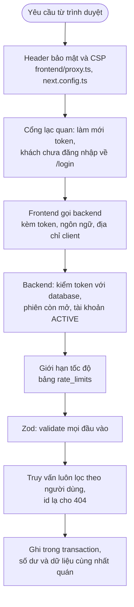

# Luồng bảo mật và chống lạm dụng

Các lớp bảo vệ chạy xuyên suốt, gom ở một chỗ: kiểm tra quyền, giới hạn tốc độ, hạn mức chi phí AI, header bảo mật, dọn dữ liệu.
Chi tiết từng lớp xem tài liệu của chức năng tương ứng.

## Các lớp bảo vệ, theo thứ tự một yêu cầu đi qua

## Kiểm tra quyền

- **Mọi** view và handler cần đăng nhập bắt đầu bằng `requireUser()` hoặc `requireAdmin()` ([auth-flow.md](auth-flow.md), [admin-flow.md](admin-flow.md)); chỉ các route công khai (đăng ký, đăng nhập, đăng xuất, làm mới token, đổi ngôn ngữ, kiểm tra sức khỏe) không cần.
- Token không đủ: mỗi yêu cầu còn kiểm database xem người dùng `ACTIVE` và **phiên còn mở**, nên khóa tài khoản, đăng xuất, đổi mật khẩu có tác dụng ngay.
- **Cách ly người dùng**: mọi truy vấn có `userId` của người đang đăng nhập. Id của người khác và id không tồn tại cho **cùng** kết quả, không lộ sự tồn tại. Ví của một giao dịch phải là của người này; danh mục phải là của người này hoặc của hệ thống.
- Frontend không có quyền gì ngoài việc chuyển tiếp: không chạm database, không giữ bí mật, và một luật ESLint cấm import mã backend/database vào frontend.

## Giới hạn tốc độ (bảng `rate_limits`)

Bộ đếm **theo khóa và theo cửa sổ thời gian cố định**, lưu trong database ([backend/src/rate-limit.ts](../backend/src/rate-limit.ts)) nên **không mất khi khởi động lại và dùng chung mọi tiến trình**. Mỗi lần `INSERT … ON CONFLICT … DO UPDATE` cộng một và trả tổng mới, một thao tác nguyên tử.

| Giới hạn | Khóa | Mức | Cửa sổ |
| --- | --- | --- | --- |
| Đăng nhập sai | Theo **email** (kể cả email không tồn tại) | 5 lần sai | 15 phút |
| Đăng nhập, mọi lần thử | Theo **địa chỉ client** | 30 (`AUTH_LIMIT_PER_IP`) | 15 phút |
| Đăng ký | Theo địa chỉ client | 10 (`REGISTER_LIMIT_PER_IP`) | 1 giờ |
| Phân tích sao kê bằng AI | Theo người dùng | 20 | 1 giờ |
| Tin nhắn chatbot | Theo người dùng | 40 | 1 giờ |
| Xuất sao kê PDF | Theo người dùng | 30 | 1 giờ |
| Token AI | Cả hệ thống / từng người | 2.000.000 / 200.000 (`AI_DAILY_TOKEN_BUDGET`, `AI_USER_DAILY_TOKEN_BUDGET`) | 1 ngày |

- Giới hạn đăng nhập kiểm **trước khi băm mật khẩu**, nên bị từ chối thì gần như không tốn gì. Email không tồn tại được đếm y hệt, nên giới hạn không lộ email nào có thật.
- **Địa chỉ client** lấy từ `X-Forwarded-For` mà frontend nhận (phần tử **cuối**, do thứ đứng ngay trước server thêm vào). Sau một reverse proxy thêm địa chỉ thì chính xác; nếu mở thẳng Next.js ra Internet, người gọi tự đặt được, khi đó giới hạn theo email và giới hạn băm đồng thời vẫn giữ.
- Khóa theo email có thể bị lợi dụng để **khóa tạm một người** (cố ý nhập sai 5 lần), cái giá của việc chống đoán mật khẩu; khóa tự hết sau cửa sổ 15 phút.
- `RATE_LIMIT_PREFIX` tách bộ đếm giữa các môi trường dùng chung database; bộ kiểm thử dùng nó (`e2e:`) để dọn sạch bộ đếm của lần chạy.

## Mật khẩu và phiên

- Băm **scrypt**, tối đa 4 phép băm đồng thời và 32 yêu cầu chờ (quá thì từ chối ngay) để một đợt tấn công không nghẽn server.
- Đăng nhập tốn cùng thời gian dù email có tồn tại hay không.
- Access token 15 phút, refresh token xoay vòng, phát hiện dùng lại thì thu hồi mọi phiên; cookie `httpOnly`, `sameSite=lax`, `secure` ở production ([auth-flow.md](auth-flow.md)).
- **Chuyển hướng sau đăng nhập** chỉ tới đường dẫn nội bộ (danh sách ký tự cho phép), chặn mẹo chèn tab và xuống dòng.

## Header bảo mật

Đặt ở [frontend/proxy.ts](../frontend/proxy.ts) (các header đổi theo từng yêu cầu) và [next.config.ts](../frontend/next.config.ts) (header cố định):

| Header | Tác dụng |
| --- | --- |
| **Content-Security-Policy** với **nonce** mới mỗi yêu cầu | Chỉ script mang nonce đó (Next.js tự gắn cho script của nó) hoặc do chúng tải mới chạy (`strict-dynamic`). Chặn chèn script. `style-src 'self' 'unsafe-inline'` vì biểu đồ và giao diện dùng style trực tiếp; `connect-src 'self'`; `object-src 'none'`; `base-uri 'self'`; `form-action 'self'` |
| `frame-ancestors 'none'` và `X-Frame-Options: DENY` | Chống clickjacking: trang không được nhúng vào khung |
| `X-Content-Type-Options: nosniff` | Chặn trình duyệt tự đoán kiểu nội dung |
| `Referrer-Policy: strict-origin-when-cross-origin` | Không lộ đường dẫn đầy đủ sang trang khác |
| `Permissions-Policy` | Tắt camera, micro, định vị, thanh toán, USB |
| `Strict-Transport-Security` | Chỉ khi chạy HTTPS (hoặc `x-forwarded-proto: https`) |
| Bỏ `X-Powered-By` | Không báo máy chủ chạy gì |

Ở chế độ phát triển CSP cho thêm `unsafe-eval` và WebSocket (cần cho tải nóng).

## Tải file

- Giới hạn kích thước (5 MB; thân request tối đa 6 MB), số dòng, định dạng; tên file tạm là UUID kiểm bằng biểu thức chính quy để không thể thoát khỏi thư mục lưu.
- Excel được **giải nén thử với trần 25 MB** trước khi đọc (chống "zip bomb"); kích thước tự khai không được tin ([import-flow.md](import-flow.md)).
- Nội dung file tải lên **không bao giờ là chỉ dẫn** cho AI, và kết quả AI được kiểm lại từng giá trị.

## AI: chi phí và dữ liệu

- Hạn mức token theo ngày cho cả hệ thống và từng người, kiểm **trước mỗi lệnh gọi** và ghi nhận sau mỗi lệnh ([chat-flow.md](chat-flow.md), [import-flow.md](import-flow.md)).
- Trợ lý chat chỉ có **công cụ chỉ đọc**, người dùng lấy từ phiên, và chỉ nói về tài chính cá nhân.
- Nội dung hội thoại và file **không ghi log**. Với OpenAI request đặt `store: false`. `AI_PROVIDER` chọn một nhà cung cấp mà thiếu khóa thì AI **tắt hẳn**, không tự chuyển sang bên kia, nên dữ liệu không đi tới công ty mà quản trị viên không chọn.

## Toàn vẹn dữ liệu

- Số tiền là **`Decimal` đầu-cuối**, không qua số thực.
- Số dư ví, tổng đã tiết kiệm, trạng thái mục tiêu được cập nhật **trong cùng một transaction** (hoặc một câu lệnh SQL) với thay đổi tạo ra chúng, có **khóa dòng** (`FOR UPDATE`) khi hai thao tác có thể đua nhau.
- Thao tác "nhận" bản ghi bằng `UPDATE … WHERE status = …` làm bấm hai lần thành vô hại (xác nhận nhập sao kê, xóa khoản tiết kiệm).
- Lỗi không lường trước trả `500` với thông điệp chung; chi tiết chỉ nằm trong log backend.

## Dọn dữ liệu tự động ([maintenance.ts](../backend/src/maintenance.ts))

Sau khi khởi động rồi mỗi giờ (`MAINTENANCE_INTERVAL_MS`): xóa lần nhập `PENDING` quá 24 giờ cùng file tạm, xóa file trong `backend/storage/imports` không thuộc lần nhập nào và cũ hơn 24 giờ, xóa bộ đếm giới hạn cũ hơn 2 ngày.

## Hạn chế đã biết

- Giới hạn theo địa chỉ phụ thuộc `X-Forwarded-For` (xem trên).
- Khóa theo email có thể bị lợi dụng để khóa một người trong 15 phút.
- Chưa có xác minh email, nên tài khoản mới dùng được AI ngay trong phạm vi hạn mức.
- Phiên đăng nhập trước khi có mã phiên (`sid`) phải đăng nhập lại một lần.

## Kiểm thử

Bộ `auth` (chuyển hướng an toàn, khóa đoán mật khẩu, phiên), `imports` ("zip bomb", dọn lần nhập bỏ dở), `imports-ai` và `chat` (hạn mức token, giới hạn hội thoại), `ui` (không vi phạm CSP, nonce trên mọi thẻ script, các header).
