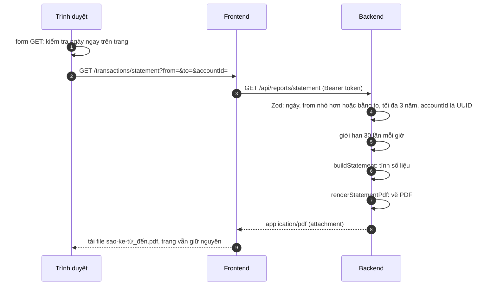

# Luồng xuất sao kê PDF

Xuất sao kê theo **khoảng thời gian tùy chọn** cho một ví hoặc tất cả ví, bố cục như sao kê ngân hàng. Nút nằm ở trang **Giao dịch**,
thẻ "Xuất sao kê PDF". Đường đi chung của yêu cầu xem [request-flow.md](request-flow.md).

## Thành phần

| Tầng | File |
| --- | --- |
| Form | [frontend/app/(app)/transactions/statement-form.tsx](../frontend/app/(app)/transactions/statement-form.tsx) |
| Route chuyển tiếp | [frontend/app/(app)/transactions/statement/route.ts](../frontend/app/(app)/transactions/statement/route.ts) |
| Route backend | `GET /api/reports/statement` trong [backend/src/routes.ts](../backend/src/routes.ts) |
| Luật nhập liệu | [backend/src/validations/report.ts](../backend/src/validations/report.ts) |
| Tính số liệu | [backend/src/reports/statement.ts](../backend/src/reports/statement.ts) |
| Vẽ PDF | [backend/src/reports/statement-pdf.ts](../backend/src/reports/statement-pdf.ts) (`pdfkit`), font [backend/assets/fonts/](../backend/assets/fonts/) |
| Hằng số và mã lỗi dùng chung | [shared/src/reports.ts](../shared/src/reports.ts) |

## Luồng

- Form là **form GET thuần** có `data-download`: trình duyệt nhận file như một lần tải xuống và **ở lại trang**; lớp phủ chờ không bật ([ui-flow.md](ui-flow.md)).
- Ngày được kiểm ngay trong form (ngày bắt đầu không sau ngày kết thúc, tối đa 3 năm) để lỗi không tốn một lần gọi; backend kiểm lại.
- Bị từ chối thì route frontend **chuyển về trang Giao dịch** với `?statementError=<mã>`, và form hiện lý do. Mã lạ trong địa chỉ bị bỏ qua, không bao giờ hiển thị nguyên văn.

## Cách tính số liệu

Bố cục lấy từ sao kê ngân hàng: số dư đầu kỳ, **ghi nợ** (tiền ra: khoản chi, chuyển đi), **ghi có** (tiền vào: khoản thu, nhận chuyển khoản), số dư cuối kỳ.

| Phần | Một ví | Tất cả ví |
| --- | --- | --- |
| Tiền tệ | Của ví, nên khớp đúng số dư của ví | Tiền tệ mặc định của người dùng |
| Số dư đầu kỳ | Số dư ban đầu của ví **cộng** mọi giao dịch trước ngày bắt đầu | Số dư ban đầu của các ví (đổi theo tỷ giá của **ngày bắt đầu**) cộng bản chụp quy đổi của giao dịch trước ngày bắt đầu |
| Mỗi dòng | Số tiền gốc theo tiền tệ ví | Bản chụp quy đổi của giao dịch; cột "Số tiền gốc" giữ tiền tệ ban đầu |
| Chuyển khoản | Chỉ một phía của ví đó | Hiện **cả hai phía**, kèm tên ví ở cuối diễn giải |
| Số dư cuối kỳ | Đầu kỳ + ghi có − ghi nợ | Như vậy |

- **Giao dịch chưa có tỷ giá** (chỉ ở chế độ "tất cả ví") vẫn được liệt kê nhưng không cộng vào tổng; phần ghi chú cuối sao kê nói rõ số lượng. Tương tự khi số dư ban đầu của một loại tiền không có tỷ giá.
- Diễn giải của mỗi dòng: tên danh mục (đã dịch theo ngôn ngữ người dùng) + ghi chú, hoặc "Chuyển đến X" / "Nhận từ Y".
- Cột "Ngày ghi nhận" là ngày giao dịch được nhập vào app (`createdAt`).

## Giới hạn

| Giới hạn | Giá trị | Mã lỗi |
| --- | --- | --- |
| Khoảng thời gian | Tối đa 3 năm (1096 ngày) | `range` |
| Ngày không hợp lệ hoặc `from` sau `to` | | `invalid` |
| Số giao dịch trong kỳ | Tối đa 3.000 | `rows` |
| Số lần xuất | 30 mỗi giờ mỗi người | `busy` (`429`) |
| Ví không có hoặc của người khác, hoặc `accountId` không phải UUID | | `account` (`404`) |

## Cách vẽ PDF

- Khổ **A4**, bố cục theo trang 1 mẫu sao kê Techcombank: logo FINANCIAL MANAGEMENT, tiêu đề, khối thông tin chủ tài khoản, bảng tóm tắt có viền, thanh "A. Thông tin chi tiết", bảng giao dịch, các dòng tổng, "Kết Thúc Sao Kê", chân trang có số trang.
- Nhãn **song ngữ** (tiếng Việt, tiếng Anh nghiêng bên dưới), nên một file dùng được cho cả hai ngôn ngữ giao diện.
- Sang trang tự động: mỗi trang lặp lại thanh tiêu đề "(tiếp theo)" và các cột; chỉ trang cuối có "Kết Thúc Sao Kê". Dòng có diễn giải dài tự xuống dòng, không bị cắt.
- **Font Noto Sans** (thường, đậm, nghiêng, giấy phép OFL) nhúng vào file, vì font có sẵn trong trình đọc PDF không đủ dấu tiếng Việt.
- **Dấu tiếng Việt và sao chép/tìm kiếm**: Noto Sans tách chữ có dấu nặng (ạ, ị, ụ…) thành chữ gốc cộng dấu rời; pdfkit khi đó ghi bảng ánh xạ sai, khiến mọi chữ sau đó sao chép thành ký tự rác. Mã vẽ PDF tắt bước tách (`ccmp`) và chuẩn hóa chữ về dạng dựng sẵn (NFC), nên chữ trong file sao chép và tìm kiếm đúng.

## Kiểm thử

Bộ `statement` (22 kiểm tra): đọc ngược chữ trong PDF bằng [tests/pdf-text.mjs](../tests/pdf-text.mjs) để kiểm từng con số (một ví, tất cả ví, chuyển khoản hai phía, giao dịch thiếu tỷ giá, nhiều trang, các từ chối, giới hạn mỗi giờ); `ui` (kiểm tra ngày trên form, tải file không bật lớp phủ chờ).
