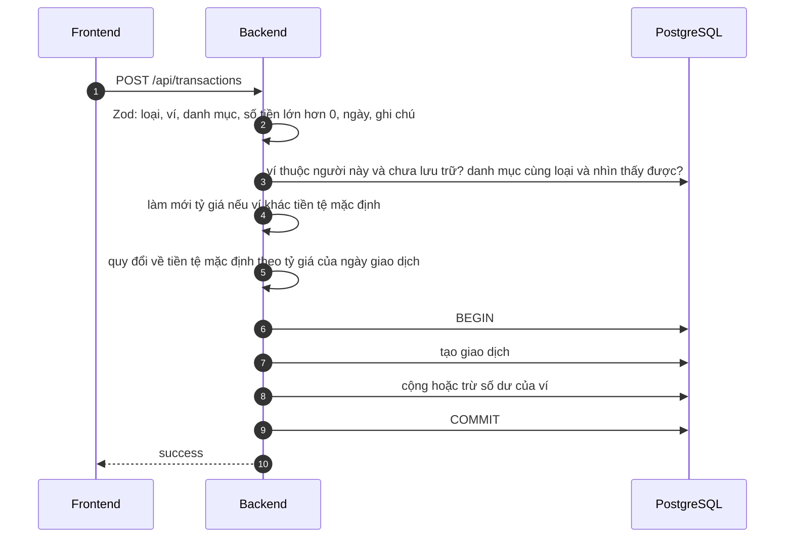

# Luồng giao dịch và chuyển khoản

Ghi khoản thu, khoản chi, chuyển tiền giữa hai ví; xem, lọc, sửa, xóa. Đường đi chung của yêu cầu xem [request-flow.md](request-flow.md).

## Thành phần

| Tầng | File |
| --- | --- |
| Trang | [frontend/app/(app)/transactions/](../frontend/app/(app)/transactions/): danh sách và lọc, form thêm (`transaction-form.tsx`), form chuyển khoản (`transfer-form.tsx`), trang sửa `[id]/edit` |
| Server Action | [frontend/app/actions/transactions.ts](../frontend/app/actions/transactions.ts) |
| Handler (ghi) | [backend/src/handlers/transactions.ts](../backend/src/handlers/transactions.ts) |
| View (đọc) | [backend/src/views/transactions.ts](../backend/src/views/transactions.ts) |
| Luật nhập liệu | [backend/src/validations/transaction.ts](../backend/src/validations/transaction.ts) |
| Quy đổi tiền | [backend/src/exchange.ts](../backend/src/exchange.ts) |

## Dữ liệu

Bảng `transactions`:

| Trường | Ý nghĩa |
| --- | --- |
| `type` | `EXPENSE`, `INCOME`, `TRANSFER` |
| `amount`, `currency` | Số tiền **luôn dương** và tiền tệ của ví. Chiều thu/chi do `type` quyết định |
| `amountInDefaultCurrency`, `exchangeRateUsed` | **Bản chụp** quy đổi về tiền tệ mặc định của người dùng tại ngày giao dịch. `NULL` nếu chưa có tỷ giá |
| `date`, `note` | Ngày giao dịch (cột `DATE`), ghi chú tối đa 200 ký tự |
| `source` | `MANUAL` (gõ tay) hoặc `IMPORT` (nhập sao kê) |
| `importBatchId`, `dedupeHash` | Dành cho nhập sao kê ([import-flow.md](import-flow.md)) |
| `transferGroupId`, `transferDirection` | Chỉ ở chuyển khoản: hai dòng cùng `transferGroupId`; `OUT` ở ví nguồn, `IN` ở ví đích |

## Thêm khoản thu / chi

- Số tiền: `\d{1,13}(\.\d{1,2})?`, lớn hơn 0. Ngày trong khoảng 2000–2100.
- Danh mục phải **cùng loại** với giao dịch (không gán danh mục "Lương" cho một khoản chi).
- Nếu chưa có tỷ giá cho ngày đó, giao dịch vẫn được ghi, bản chụp quy đổi để trống và được **điền sau** khi tỷ giá về ([currency-flow.md](currency-flow.md)).
- Ghi giao dịch và cập nhật số dư nằm trong **một transaction database**: hoặc cả hai xảy ra, hoặc không gì cả.

## Chuyển khoản giữa hai ví

1. Zod: ví nguồn, ví đích (**khác nhau**), số tiền, ngày, ghi chú, và `toAmount` (số tiền nhận).
2. Cả hai ví phải của người dùng và chưa lưu trữ.
3. **Khác tiền tệ** → bắt buộc nhập `toAmount` (số nhận, theo tiền tệ ví đích); app không tự đoán tỷ giá chuyển. **Cùng tiền tệ** → `toAmount` để trống hoặc bằng số chuyển.
4. Trong một transaction: tạo **hai dòng** `TRANSFER` cùng `transferGroupId` (một `OUT`, một `IN`), trừ ví nguồn, cộng ví đích.
5. Chuyển khoản **không phải thu hay chi**: không vào báo cáo thu/chi, không tính vào ngân sách ([dashboard-flow.md](dashboard-flow.md)).

## Xem và lọc

`GET /api/transactions` nhận `accountId`, `categoryId`, `type`, `from`, `to`, `page`. Tham số sai **bị bỏ qua** (không báo lỗi). Mới nhất trước, **20 dòng mỗi trang**. Với dòng chuyển khoản, backend lấy thêm tên ví đối ứng để hiện "Chuyển đến X" hoặc "Nhận từ Y".

Bộ lọc là form `next/form`: lọc là một lần điều hướng trong app (không tải lại cả trang), nên nút Quay lại về bộ lọc trước gần như tức thì. Ô lọc được dựng lại theo địa chỉ sau mỗi lần đổi.

## Sửa

- Chỉ sửa được khoản **thu/chi**. Chuyển khoản không sửa được (là một cặp liên kết): muốn đổi thì xóa rồi tạo lại.
- Trong một transaction, có **khóa dòng** (`FOR UPDATE`) để hai thao tác sửa/xóa cùng lúc chờ nhau: **hoàn lại** số dư theo giá trị cũ, ghi giá trị mới, **cộng** số dư theo giá trị mới. Có thể chuyển sang ví khác (không được chuyển vào ví đã lưu trữ).
- Quy đổi được tính lại theo ngày và số tiền mới.

## Xóa

Xóa một giao dịch hoàn lại số dư. Xóa **một bên** của chuyển khoản sẽ xóa **cả hai bên** và hoàn lại cả hai ví. Có modal xác nhận.

## Trường hợp lỗi

| Tình huống | Kết quả |
| --- | --- |
| Số tiền không hợp lệ hoặc bằng 0 | Lỗi ở trường số tiền |
| Ví không tồn tại, của người khác, hoặc đã lưu trữ | Lỗi ở trường ví |
| Danh mục không có hoặc khác loại | Lỗi ở trường danh mục |
| Chuyển khoản khác tiền tệ nhưng thiếu số nhận | Lỗi ở trường số nhận |
| Hai ví giống nhau | Lỗi ở ví đích |
| Sửa giao dịch không có, của người khác, hoặc là chuyển khoản | "Không tìm thấy giao dịch." |

## Kiểm thử

Bộ `transactions` (thu, chi, chuyển khoản kể cả khác tiền tệ, số dư, lọc, phân trang), `language-currency` (quy đổi), `ui` và `mobile` (xóa có xác nhận, lọc, thêm bằng bàn phím ảo).
