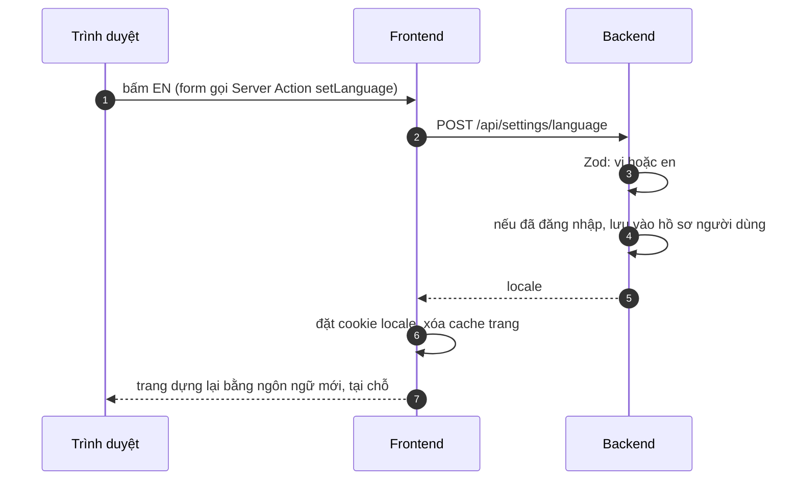
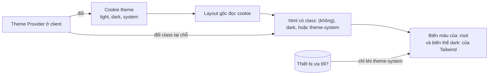

# Luồng giao diện: bố cục, ngôn ngữ, giao diện sáng/tối, trạng thái chờ, xác nhận

Những hành vi dùng chung của giao diện, không thuộc riêng chức năng nào. Đường đi dữ liệu xem [request-flow.md](request-flow.md).

## Bố cục và điều hướng

| Thiết bị | Bố cục |
| --- | --- |
| Máy tính (từ `lg`) | **Thanh bên** cố định bên trái: logo, menu đầy đủ, người dùng, nút VI/EN, nút sáng/tối, đăng xuất |
| Điện thoại | **Header** có logo, VI/EN, sáng/tối, đăng xuất; **thanh điều hướng dưới đáy** có 4 mục chính (Tổng quan, Giao dịch, Ngân sách, Tiết kiệm) và mục **Thêm** mở phần còn lại (Nhập sao kê, Tài khoản, Danh mục, Cài đặt, và mục admin nếu có) |

Nội dung và nút chat tránh vùng thanh dưới; giao diện hoạt động từ khổ 320 px, thao tác chạm đủ lớn. Menu: [components/nav-links.tsx](../frontend/components/nav-links.tsx); bố cục: [frontend/app/(app)/layout.tsx](../frontend/app/(app)/layout.tsx) và [(auth)/layout.tsx](../frontend/app/(auth)/layout.tsx) (đăng nhập, đăng ký: biểu mẫu một bên và bảng thương hiệu bên kia ở màn hình rộng).

Khi bấm một liên kết, mục tương ứng mờ và nhấp nháy cho tới khi trang đến (`useLinkStatus`).

## Ngôn ngữ (tiếng Việt, English)

- **Cookie `locale`** là nguồn duy nhất khi dựng trang. Nó được đồng bộ với hồ sơ khi **đăng nhập** (đăng nhập trên thiết bị mới thì mang theo ngôn ngữ đã lưu) và mỗi lần đổi. Đổi được cả khi chưa đăng nhập.
- **Câu tiếng Việt là khóa dịch** ([shared/src/i18n/](../shared/src/i18n/)): `t("Giao dịch")` ở tiếng Việt cho nguyên văn, ở tiếng Anh tra `en.ts`, thiếu bản dịch thì **rơi về tiếng Việt** chứ không hiện khóa trần. `{0}`, `{1}` là chỗ điền giá trị.
- Server Component dùng `getI18n()`; thành phần client dùng `useI18n()` (từ `I18nProvider` ở layout gốc). Backend dịch thông báo của nó theo header `x-locale`, nên lỗi từ server cũng đúng ngôn ngữ.
- **Số tiền và ngày** định dạng bằng `Intl` theo ngôn ngữ (`vi-VN`, `en-US`). Tên **danh mục hệ thống** được dịch; tên do người dùng đặt giữ nguyên.
- Mọi câu mới phải có bản dịch trong `en.ts`; bộ kiểm thử `language-currency` quét trang tiếng Anh để bắt chỗ còn sót tiếng Việt.

## Giao diện sáng / tối

- Ba lựa chọn: **Sáng**, **Tối**, **Theo thiết bị** (mặc định). Đổi nhanh bằng nút mặt trăng/mặt trời cạnh VI/EN; đủ ba lựa chọn ở **Cài đặt → Giao diện**.
- Lựa chọn lưu trong **cookie `theme` của từng thiết bị** (không lưu vào hồ sơ). Server đọc cookie và đặt class lên `<html>` ngay từ byte đầu, nên **không nháy nền sai màu** khi tải.
- **Theo thiết bị** làm bằng **CSS thuần** (`@media (prefers-color-scheme: dark)` trong biến thể `dark` của [globals.css](../frontend/app/globals.css)), không cần script chạy trước khi vẽ, nên tương thích với Content Security Policy ([security-flow.md](security-flow.md)).
- Đổi giao diện **không tải lại trang**: `ThemeProvider` đổi class và cookie tại chỗ. Biểu tượng nút được chọn bằng CSS (`dark:`) nên đúng ngay cả khi lựa chọn là "theo thiết bị".
- Bảng màu "tím đêm" được định nghĩa một lần bằng biến CSS; `color-scheme` làm cả thành phần của trình duyệt (thanh cuộn, ô chọn ngày, danh sách thả xuống) chuyển tối. Biểu đồ có bộ màu riêng cho nền tối; màu trạng thái (xanh, vàng) được làm sáng hơn trên nền tối.
- Mã: [lib/theme.ts](../frontend/lib/theme.ts), [components/theme-provider.tsx](../frontend/components/theme-provider.tsx), [theme-toggle.tsx](../frontend/components/theme-toggle.tsx).

## Trạng thái chờ khi chuyển trang

Lớp phủ khung xương (skeleton) cho người dùng biết trang đang tải, mà không nháy với thao tác nhanh. Dựng ở [components/navigation-pending.tsx](../frontend/components/navigation-pending.tsx) ngoài `loading.tsx`, vì `loading.tsx` bắt đầu trả trang với mã 200 trước khi biết bản ghi có tồn tại không, làm mọi "không tìm thấy" thành 200.

| Khởi phát | Hiện sau | Hết khi |
| --- | --- | --- |
| Bấm liên kết nội bộ | **150 ms** | Trang mới đến |
| Gửi form GET dẫn tới trang khác (bộ lọc) | 150 ms | Trang mới đến |
| Bấm **Quay lại / Tiến tới** tới trang phải tải lại | 150 ms | Trang mới đến |
| Form có Server Action kết thúc bằng chuyển trang (`FormNavigationMarker`) | **400 ms** | Trang mới đến, hoặc form báo lỗi và ở lại |
| Form tải file (có `data-download`) | Không hiện | |

- Lớp phủ được **thêm và gỡ trực tiếp trên DOM**, không qua trạng thái của React. Lý do: khi quay lại một trang router phải tải lại, React giữ mọi cập nhật tới khi trang đó về, nên lớp phủ dựng bằng React chỉ hiện khi đã hết cần.
- Quay lại một trang mà router còn giữ (gần như tức thì, 15–70 ms) không hiện gì. Sau mỗi lần **lưu** một thay đổi, router bỏ các trang đã giữ (có thể chứa số liệu cũ), nên lần Quay lại kế tiếp phải tải lại và hiện lớp phủ.
- **Bộ lọc giao dịch** dùng `next/form`: lọc là điều hướng trong app (không tải lại cả trang), nên Quay lại từ trang đã lọc cũng nhanh.
- Có chốt chặn: **10 giây** không xong thì gỡ lớp phủ.

## Hộp xác nhận (modal)

Mọi thao tác phá hủy đi qua [`ConfirmButton`](../frontend/components/confirm-button.tsx), dựng trên `AlertDialog` ([components/ui/alert-dialog.tsx](../frontend/components/ui/alert-dialog.tsx)); **không** dùng `window.confirm`:

- Bố cục: **biểu tượng tròn** (thùng rác / hoàn tác / đăng xuất; đỏ cho thao tác phá hủy, màu chủ đạo cho thao tác thường như đăng xuất), **tiêu đề ngắn dạng câu hỏi**, mô tả hệ quả (mặc định "Thao tác này không thể hoàn tác.") và, nếu có, **ô tên đối tượng** (tên tệp, danh mục, mục tiêu) tách riêng để tên dài không làm vỡ câu. Hai nút: **Hủy** và hành động có tên rõ ("Xóa", "Hoàn tác", "Đăng xuất").
- Props của `ConfirmButton`: `confirmMessage` (tiêu đề), `confirmSubject`, `confirmDetail`, `confirmLabel`, `confirmIcon` (`trash` | `undo` | `logout` | `warning`, truyền theo tên vì Server Component không truyền được hàm) và `confirmTone` (`destructive` | `default`).
- **Hủy được focus sẵn** nên lỡ nhấn Enter cũng không xóa; **Esc** là hủy; bấm ra ngoài modal không làm gì; focus bị giữ trong modal; trình đọc màn hình nhận ra đây là hộp cảnh báo (`role="alertdialog"`).
- Bấm nút hành động thì **gửi form** của nút gốc (modal nằm ngoài form, trong portal, nên form được gửi hộ). Không có JavaScript: nút gửi form trực tiếp.
- Dùng ở: xóa giao dịch, ngân sách, mục tiêu tiết kiệm, danh mục, lần nhập; hoàn tác lần nhập; đăng xuất khỏi mọi thiết bị.
- Máy tính: thẻ ở giữa màn hình, biểu tượng bên trái chữ, hai nút căn phải. Điện thoại: **tấm trượt từ mép dưới** (có thanh nắm, chừa vùng an toàn), biểu tượng ở trên chữ, hai nút xếp dọc rộng hết khung, hành động chính ở trên.

## Mẫu biểu mẫu

Mọi form theo cùng một mẫu: [`useActionState`](https://react.dev/reference/react/useActionState) gọi Server Action, nhận `FormState` ([request-flow.md](request-flow.md)).

- `errors` hiện dưới từng trường (`FieldError`, `aria-invalid`, `aria-describedby`), `message` ở đầu form (`FormMessage`, `role="alert"`), `success` là dòng trạng thái (`role="status"`).
- **Giữ những gì đã gõ** khi lỗi (`values` điền lại), **xóa trắng** khi thành công; ô chọn dùng `key` để dựng lại theo giá trị mới.
- Cột và lưới hai cột dùng `content-start`, nên ô thấp hơn không bị đẩy xuống khi ô cạnh có gợi ý dài hoặc báo lỗi.
- Form cập nhật **tại chỗ** (không tải lại trang): danh sách cập nhật vì frontend xóa cache sau mỗi lệnh ghi.

## Trang lỗi và không tìm thấy

| Trường hợp | Trang |
| --- | --- |
| Bản ghi không có, không phải của bạn, hoặc admin route gọi bởi người thường | "Không tìm thấy trang" kèm điều hướng (trả mã `404` thật) |
| Backend lỗi, hoặc lỗi dựng trang | "Đã xảy ra lỗi", nút **Thử lại** và **Về trang tổng quan**, kèm mã lỗi (digest) để tra log; thông báo lỗi gốc **không** hiển thị vì có thể chứa chi tiết nội bộ |
| Lỗi ở layout gốc | `global-error` (trang tối giản, không phụ thuộc giao diện) |
| Danh sách rỗng | Câu trạng thái rỗng riêng của từng trang, ví dụ "Chưa có giao dịch nào." |

## Kiểm thử

| Bộ | Nội dung |
| --- | --- |
| `ui` (47) | Trình duyệt thật: biểu đồ, modal xác nhận (Hủy, Esc, Xóa), lớp phủ chờ cả khi Quay lại, lọc không tải lại trang, tải sao kê, giao diện tối (kể cả ô chọn), trang lỗi, khung chat |
| `mobile` (29) | Giả lập điện thoại: bố cục 320–740 px, chạm, bàn phím ảo, modal dạng tấm trượt ở mép dưới, nút rộng hết khung |
| `states` (19) | Trạng thái rỗng, lỗi, không tìm thấy |
| `language-currency` (47) | Đổi ngôn ngữ, bản dịch |
